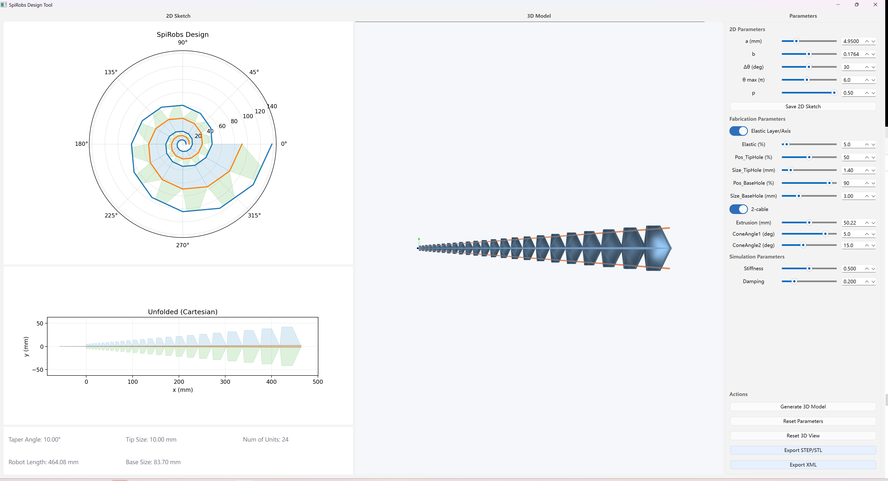
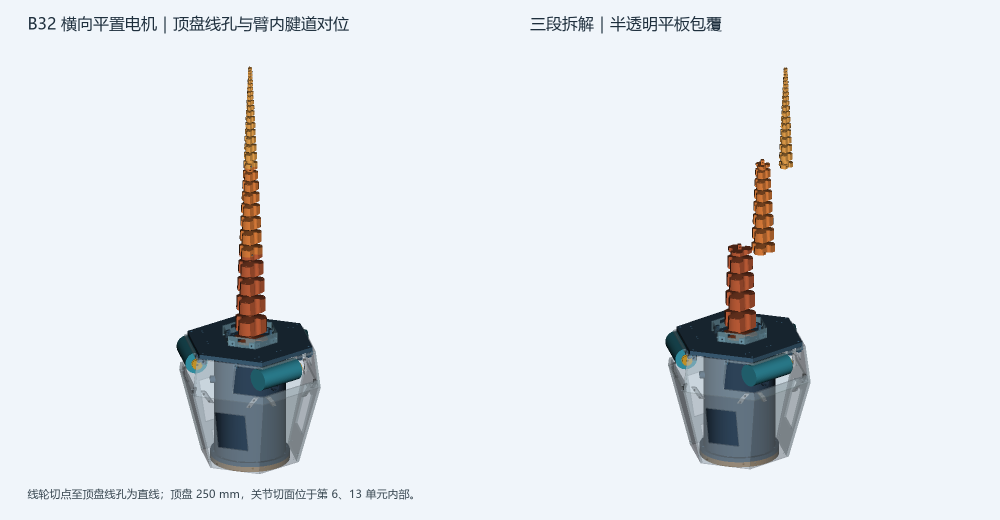

# Spiral Soft Arm 研究与工程验证仓库

本仓库基于 [Open Spiral Robots（OpenSpiRobs）](https://github.com/ZhanchiWang/Open-Spiral-Robots) 派生，保留其参数化设计工具，并继续整理本地 B32 三缆对数螺旋软体臂的几何、CAD、仿真、硬件布局和打印前验证工作。仓库由本地项目维护，不代表上游项目的官方版本或研究结论。

项目目前处于**设计与验证阶段**：有已归档的几何模型、仿真和 CAD 候选，但还没有完成整机打印、水下密封或负载任务验证。README 中把设计目标、数字检查、仿真结果和实物证据分开说明。

## 目录

- [项目目标与系统边界](#项目目标与系统边界)
- [B32 几何基线](#b32-几何基线)
- [机械与电子集成候选](#机械与电子集成候选)
- [仿真研究与当前结果](#仿真研究与当前结果)
- [项目模块和目录](#项目模块和目录)
- [安装与运行](#安装与运行)
- [验证状态与下一步](#验证状态与下一步)
- [候选版本和证据管理](#候选版本和证据管理)
- [上游来源、引用与许可](#上游来源引用与许可)

## 项目目标与系统边界

当前 B32 研究目标是构建一套三腱驱动的对数螺旋软体臂，并为淡水和海水环境中的抓取任务建立可追溯的几何、仿真、驱动和制造验证流程。以下是整机设计目标或当前布局假设，**不是已经通过的性能指标**：

| 需求 | 当前方案/假设 | 验证状态 |
| --- | --- | --- |
| 工作环境 | 淡水和海水；目标深度 5 m | 尚无压力舱、密封或水下运行验证 |
| 单次工作时间 | 约 30 分钟 | 尚无整机功耗、温升和续航实测 |
| 岸上供电 | 隔离 24 V；现有脐带缆两芯各 4 mm²、5 m | 三台电机按额定工作点约需 30 A；现有线缆压降估算约 1.3 V，需限流或换粗线，并实测温升 |
| 断电备份 | 4S1P、8 Ah 电池经 BMS 与 24 V 升压进入 UPS；岸电在时关闭升压，岸电失效才启用；备电总输出限流 | 约 15 分钟目标对应降功率模式；三台电机额定负载下所需能量高于当前电池标称能量 |
| 执行器布局 | 当前 v23 几何候选将三台 DJI M3508 P19 竖装在共用干仓内，经 1:1 干式直角齿轮驱动湿侧水平切向线盘；拉索从线轮上侧切点直线穿过顶盘斜孔，再由根部曲面通道接入原腱道 | STEP 回读与静态干涉审查通过；商品齿形、根部强度、仓体密封、轴承载荷与温升未验证 |
| 控制与功率电子 | v25采用STM32F407ZGT6、三只C620、4节21700、UPS、PD1002、理想二极管、4S40A保护板、M28岸电口、M12 Type-C辅助口及42×24×5 mm的24→5 V降压模块 | M28图纸尺寸和降压模块已加入模型；保护板孔位、CAN密封走线、线束、散热和水压仍待落实 |
| 电机候选 | 大陆可采购的 DJI M3508 P19，配套 C620 使用 CAN 指令或 PWM；持续最大输出扭矩标称 3 N·m | 三台额定工作电流合计约 30 A；24 V/15 A 模块仅在备电支路，主路需按新拓扑配电 |
| 电池候选 | 4S1P 松下 NCR21700T；用户确认每节 8 Ah，电池组仍为 8 Ah | BMS、电芯持续放电能力、变换效率和实际续航仍需器件资料与测试 |
| 辅助输入 | USB‑C PD 同时作为 UPS AUX 辅助输入和 4S 备用充电输入；岸电优先充电，Type‑C 输入受 PD 总功率限流 | 双输入防回灌、PD 电压合同、功率分配和满载热设计仍待核对 |

4S1P 按 14.8 V 标称电压与 8 Ah 估算约 118.4 Wh；备电时长仍须在实际负载下验证。当前供电方案见[M3508/C620 供电拓扑重规划](local/spiral-soft-arm/hardware/M3508_C620_供电拓扑重规划_2026-10-25.md)，旧[硬件拓扑图](local/spiral-soft-arm/hardware/硬件连接拓扑图_2026-10-22.png)为 4092/mini ESC 历史方案。

## B32 几何基线

B32 是本地论文构形和打印前研究的主要基线。当前参数记录给出的主体为一体式 TPU 95A 软体结构，包含离散对数螺旋轮廓、连续中央弹性轴和三条腱线通道；它不是由 32 个独立刚性关节组装成的机械臂。MuJoCo 中的刚体单元和等效关节用于降低阶模型分析，不能代替打印件的连续柔性力学。

| 参数 | 当前记录值 | 说明 |
| --- | ---: | --- |
| 螺旋单元数 | 32 | B32 候选标识中的 32 |
| 单元离散角步长 | 30° | 总离散角跨度为 960°，约 2.667 圈 |
| 螺旋增长系数 | `b = 0.13699` | 对数螺旋几何参数 |
| 截面参数 | `p = 0.5` | 本地轮廓插值参数，不是通常意义上的轴向螺距 |
| 名义主体长度 | 550.014 mm | 几何/STEP 记录值 |
| 参考基部直径 | 68 mm | 目标或参考尺寸；不等于最终实体包围盒宽度 |
| STEP 包围盒 | 66.656 × 59.500 × 550.014 mm | 导入回读的实体尺寸 |
| 尖端实际直径 | 7.359 mm | 当前基线几何值 |
| 腱线数量/方位 | 3 根，0° / 120° / 240° | 三路腱索围绕中心轴布置 |
| 弹性层 | 开启，名义占比 10% | 刚度参数仍需按实际打印材料标定 |

冻结参数、公式和适用范围详见[B32 几何参数](local/spiral-soft-arm/preprint/v2/B32几何参数.json)、[参数推导论文](local/spiral-soft-arm/preprint/v1/三缆软臂参数推导论文.md)和[论文构形几何验收记录](local/spiral-soft-arm/preprint/v2/reports/论文构形几何验收.json)。



*上图为上游设计工具界面示例；截图中的参数不是本地 B32 的冻结参数。*

## 机械与电子集成候选

### V26 原机械臂与V25电子仓整合总装

[`integrated_assembly_v26_arm_and_v25_electronics`](local/spiral-soft-arm/solidworks/integrated_assembly_v26_arm_and_v25_electronics/) 是当前独立整机候选：保持原B32五实体机械臂、燕尾分段和三路M3508机构不变，完整复用V25电子仓，并输出[整机STEP](local/spiral-soft-arm/solidworks/integrated_assembly_v26_arm_and_v25_electronics/B32_v26_原机械臂与V25电子仓整合总装.step)、[全高预览](local/spiral-soft-arm/solidworks/integrated_assembly_v26_arm_and_v25_electronics/B32_v26_整机半透明预览.png)、[根部接口近景](local/spiral-soft-arm/solidworks/integrated_assembly_v26_arm_and_v25_electronics/B32_v26_根部与电子仓接口近景.png)和[整合审查](local/spiral-soft-arm/solidworks/integrated_assembly_v26_arm_and_v25_electronics/整机整合审查.json)。该版本是静态装配与坐标审查候选，不是打印、水密或运动验证结论。

### v25 当前电源输入与M28接口候选

[`electronics_enclosure_v25_power_input_and_m28`](local/spiral-soft-arm/solidworks/electronics_enclosure_v25_power_input_and_m28/) 在v24布局上加入42×24×5 mm的STM32降压模块，并按用户提供的M28-2芯/50A图纸重做底盖接口。10 mm底盖中心采用局部沉台形成5 mm夹持区，Ø36后装法兰和承力环位于仓内侧；开孔为26.2×28 mm异形孔，并保留Ø33×71.5 mm公插头空间。为避开38.5 mm插座尾部，稳压器及上方电池托架整体上移7 mm。已输出[电子仓STEP](local/spiral-soft-arm/solidworks/electronics_enclosure_v25_power_input_and_m28/B32_v25_选定硬件电子仓.step)、[整机STEP](local/spiral-soft-arm/solidworks/electronics_enclosure_v25_power_input_and_m28/B32_v25_三路M3508与电源接口总装.step)、[半透明预览](local/spiral-soft-arm/solidworks/electronics_enclosure_v25_power_input_and_m28/B32_v25_电子仓半透明装配预览.png)、[M28细节](local/spiral-soft-arm/solidworks/electronics_enclosure_v25_power_input_and_m28/B32_v25_M28沉台与承力环细节.png)和[分层电源图](local/spiral-soft-arm/solidworks/electronics_enclosure_v25_power_input_and_m28/B32_v25_电子仓分层与电源路径图.png)。详见[v25说明](local/spiral-soft-arm/solidworks/electronics_enclosure_v25_power_input_and_m28/README.md)。

### v24 选定硬件电子仓布置基线

[`electronics_enclosure_v24_selected_hardware`](local/spiral-soft-arm/solidworks/electronics_enclosure_v24_selected_hardware/) 沿用 v23 三路 M3508 机构并重新布置 Ø136 mm 中央电子仓。四节 21700 和三只 C620 位于上层；STM32F407ZGT6、UPS 及既有 24 V 稳压器竖装；PD1002、理想二极管与 4S40A 保护板位于底层。M28 两芯岸电口设置在底盖，M12 Type-C 辅助口靠近 PD 区。已输出[电子仓 STEP](local/spiral-soft-arm/solidworks/electronics_enclosure_v24_selected_hardware/B32_v24_选定硬件电子仓.step)、[整机 STEP](local/spiral-soft-arm/solidworks/electronics_enclosure_v24_selected_hardware/B32_v24_三路M3508与选定电子仓总装.step)、[半透明预览](local/spiral-soft-arm/solidworks/electronics_enclosure_v24_selected_hardware/B32_v24_电子仓半透明装配预览.png)和[分层布局](local/spiral-soft-arm/solidworks/electronics_enclosure_v24_selected_hardware/B32_v24_电子仓分层布局图.png)。现为外形布置候选，具体连接器开孔、板卡固定孔、通信穿仓和水密尚未定型；详见[v24 说明](local/spiral-soft-arm/solidworks/electronics_enclosure_v24_selected_hardware/README.md)。

### v23 当前拉索与轴封接口候选

[`electronics_enclosure_v23_cable_and_seal_interfaces`](local/spiral-soft-arm/solidworks/electronics_enclosure_v23_cable_and_seal_interfaces/) 整合三台 M3508、共用干仓、CNC D 轴联轴套、三路湿侧线轮及输出轴封座。线轮上侧切点至顶盘根部入口为直线；顶盘采用 Ø4.2 mm 斜孔，根部前 60 mm 使用平滑导入通道接回 B32 原腱道。电机 D 轴轴套位于干仓内；三只 10×22×7 mm 轴封位于完整 Ø10 输出轴跑道上，集成座孔以打印后精加工到 Ø22 H8 为目标。[总装 STEP](local/spiral-soft-arm/solidworks/electronics_enclosure_v23_cable_and_seal_interfaces/B32_v23_M3508三路拉索与轴封接口总装.step)、[总装预览](local/spiral-soft-arm/solidworks/electronics_enclosure_v23_cable_and_seal_interfaces/B32_v23_M3508三路总装预览.png)、[拉索尺寸图](local/spiral-soft-arm/solidworks/electronics_enclosure_v23_cable_and_seal_interfaces/B32_v23_拉索直线与根部过渡尺寸图.png)及[几何审查说明](local/spiral-soft-arm/solidworks/electronics_enclosure_v23_cable_and_seal_interfaces/README_拉索过渡与轴封接口.md)可供审核。该版完成静态几何核查，尚未通过切片、材料试件、压力或水下运行验证。

### v16 历史根部驱动候选

早期改型保存在 [`electronics_enclosure_v16`](local/spiral-soft-arm/solidworks/electronics_enclosure_v16/)：三台中国大陆可采购的 M3508 P19 原厂减速电机竖装，三块 C620 置于共用干仓底部。电机 Ø10 mm 输出轴通过可拆联轴器连接独立竖轴，再经 KHK 1:1 配对伞齿轮驱动水平切向线盘轴。输出轴由双列角接触轴承支承，穿仓处留有迷宫结构及 10 × 22 × 7 mm 骨架油封座。湿侧卷芯切点至线孔约 13.76 mm，保持径向直线出线。提供[总装 STEP](local/spiral-soft-arm/solidworks/electronics_enclosure_v16/B32_v16_减速电机直角传动总装.step)、[半透明预览](local/spiral-soft-arm/solidworks/electronics_enclosure_v16/B32_v16_半透明总装预览.png)、[俯视图](local/spiral-soft-arm/solidworks/electronics_enclosure_v16/B32_v16_线盘线孔俯视.png)及[布置审计](local/spiral-soft-arm/solidworks/electronics_enclosure_v16/装配布置审计.json)。齿轮齿形仍为商品包络，5 m 水密与三机同时供电尚未验证。

### v15 历史根部驱动候选

[`electronics_enclosure_v15`](local/spiral-soft-arm/solidworks/electronics_enclosure_v15/) 保留三台 M2006 竖装、水平切向线盘轴和仅预留齿轮空间的历史装配候选。该版的 250 mm 六边形顶盘、机械臂分段和倒角线孔作为 v16 的几何基础。

### v14 历史根部驱动候选

[`electronics_enclosure_v14`](local/spiral-soft-arm/solidworks/electronics_enclosure_v14/) 保留竖装电机与同轴竖直线盘的布局。该版的电池、支撑件和仓壁静态空间重排作为 v15 的基础，但线盘轴向由 v15 修正。

### v13 历史根部驱动候选

[`electronics_enclosure_v13`](local/spiral-soft-arm/solidworks/electronics_enclosure_v13/) 保留初次紧凑竖装方案与原预览，作为 v14 重排前的对照。

### v12 历史根部驱动候选

上一版保存在 [`electronics_enclosure_v12`](local/spiral-soft-arm/solidworks/electronics_enclosure_v12/)：三台 M2006 P36 水平收拢于顶盘下方，后端盖经三条干侧接线管通向下移的中央电子仓。该版保留为布置对照资料。

### v11 历史根部驱动候选

前一版保存在 [`electronics_enclosure_v11`](local/spiral-soft-arm/solidworks/electronics_enclosure_v11/)：三台 M2006 P36 位于各自的干式电机筒内，旧预览未显示完整后盖，电机筒也突出外罩。它保留为对照资料，不作为当前水密布局。

### v9 历史根部总装候选

早期 4092 湿侧驱动的根部结构保存在 [`electronics_enclosure_v9`](local/spiral-soft-arm/solidworks/electronics_enclosure_v9/)。该目录提供 STEP 总装、拆分件 STL、生成脚本、参数、几何审计和 SHA‑256 清单。

- 软臂分为三段；燕尾榫切面位于第 6 和第 13 关节单元内部，并用横向锁销代理定位。三段网格轴向长度约为 182.95、185.10、199.96 mm，低于项目提出的 250 mm 有效成型高度；打印方向、XY 占用、切片路径和实际装配还未核验。
- 顶盘为 250 mm 对角尺寸的六边形。含安装耳的审计包围盒约为 221.49 × 250 mm。
- 三台湿侧电机水平放置，轴线沿切向；三只线轮按切线方向出线。顶盘孔和机械臂入口在模型俯视图中对齐，线轮切点到顶盘孔的自由段建成直线代理。
- 外部平面包覆件由分片面板组成，留有电机检修窗和观察开口。外罩与水连通，属于防护/布局件，**不是压力壳，也不构成密封证明**。
- 电子仓和湿侧机构的模型空间已用于排布讨论，但电机真实轴端、线轮锁轴和绕线容量、接插件、线缆导向与密封边界仍未按实物冻结。



v9 的审计状态是“CAD 与预览候选”，并非打印或水下放行。模型还未建成线轮卷绕释放过程、完整圆滑导向和腱线进入臂内通道的可打印过渡结构；动态避让、燕尾疲劳、TPU 蠕变、锁销保持和细连接条强度均未通过实物验证。逐项说明见[v9 设计说明](local/spiral-soft-arm/solidworks/electronics_enclosure_v9/README_水平转位与线轮切线对孔.md)和[分段与装配几何审计](local/spiral-soft-arm/solidworks/electronics_enclosure_v9/分段与装配几何审计.json)。

### 电机、线轮、电子仓与供电

- **当前驱动**：v23 采用三台 DJI M3508 P19 与 C620；电机、齿轮和 CNC D 轴套在共用干仓内，线轮在湿侧。线轮至顶盘为直线，根部用曲面导入段接原腱道。C620 支持 CAN 指令及 PWM；轴封适水性、穿线件和动态负载仍需验证。M2006/C610、4092/mini ESC 为历史候选。
- **控制器**：系统方案采用 STM32 作为中央控制器，由各电调完成三相换相和本地功率保护。仓库目前没有 STM32 固件工程，因此尚未实现三轴闭环、限位、通信超时、故障锁定或急停逻辑。
- **UPS 与电池**：当前拓扑按岸上隔离 24 V、4S1P 松下 NCR21700T（用户确认每节 8 Ah）、BMS 后 9–35 V→24 V/15 A 变换器及限流备电路径绘制。岸上 24 V 与 USB‑C PD 均可通过岸电优先选源级和共用 16.8 V CC/CV 充电级给电池充电；两种输入不直接并联。Type‑C PD 还分支供 UPS AUX，按 PD 合同总功率限制充电与 AUX 负载；任一外部电源有效时关闭电池升压。STM32 从 24 V 控制母线经单级 24→5 V 降压供电。电池实际放电能力、变换器效率、切换时间、再生制动回灌和运行时长仍未实测。
- **包覆与密封**：外部平板包覆件和内部密封电子仓是不同部件。外罩观察口用于检查/排水，不是压力平衡或承压结构的认证；电子仓也没有完成 5 m 压力和渗漏测试。

### 其他保留的机械候选

仓库保留多轮电机安装与电子仓布局，便于比较尺寸、走线和装配方式。`electronics_enclosure_v1` 至 `v16` 为历史设计记录；v18 官方电机 CAD、v20 驱动模组和 v21 CNC 轴套是 v23 的来源，v23 是当前接口几何候选。旧版尺寸或验证状态不能直接套用到 v23。`solidworks/user_3_0/` 是独立一体式几何试验线，`solidworks/v2_rigid_links/` 是刚性连杆姿态模型，二者都不能替代连续 TPU 的 B32 基线。

## 仿真研究与当前结果

水下 MuJoCo 研究通过 B32 基线建立 32 个刚体代理、31 个等效柔性关节、三路腱索和线轮约束，并加入浮力、目标物和现象学流体阻力。`local/spiral-soft-arm/simulation/v3/` 保存仿真脚本、输入配置和逐工况 CSV/JSON；`local/spiral-soft-arm/preprint/v4/` 保存当前较新的参数推导和评估报告。

当前 v4 报告覆盖淡水/海水、1 m/5 m 共四种工况：每种运行 8000 步且状态有限，但四种工况均未达到目标物抬升 5 mm 的任务门槛；候选搜索也没有发现通过全部门槛的可行设计。因此报告不宣称找到了成功的最优参数或合格驱动器。

仿真的关键边界：

- 1 m 与 5 m 运动工况使用相同运动学输入，水深压力作为元数据；压力没有耦合到外壳应力或形变。
- 流体作用是 MuJoCo 的简化模型，不是 CFD；模型未标定实际 TPU 曲线、腱索松弛/弹性、线轮多层绕线、真实电机电流环、密封和材料吸水。
- 使用理想化驱动参数或有限元之外的弹簧/阻尼刚体近似，不能据此证明实物抓取、材料强度、电机温升或水下安全。
- 目标物任务失败属于当前模型和参数范围内的负结果；不能通过单纯提高腱力上限推断实机性能会改善。

详细结论见[v4 水下驱动评估报告](local/spiral-soft-arm/preprint/v4/水下驱动评估报告.md)、[v4 参数推导论文](local/spiral-soft-arm/preprint/v4/B32水下驱动参数推导论文.md)和[逐工况仿真代码](local/spiral-soft-arm/simulation/v3/)。

## 项目模块和目录

| 目录 | 内容 | 当前说明 |
| --- | --- | --- |
| [`design-tool/`](design-tool/) | OpenSpiRobs Python 图形设计工具、螺旋几何模块、CAD/XML 导出和界面截图 | 用于交互式设计与导出；不代表本地 B32 已打印 |
| [`design-tool/blender/`](design-tool/blender/) | Blender 候选生成、几何检查、来源锁定与打样包构建脚本 | 包含 B32、B31、B33 等几何候选；候选比较不等于实物评估 |
| [`local/spiral-soft-arm/stage-a/`](local/spiral-soft-arm/stage-a/) | Blender 阶段 A 的候选 STL、检查脚本与结果 | 几何/拓扑阶段记录 |
| [`local/spiral-soft-arm/preprint/`](local/spiral-soft-arm/preprint/) | v1–v4 参数推导、预打印包、仿真说明和验证记录 | 各版研究边界不同，v2 打印门槛和 v4 水下驱动报告需分别阅读 |
| [`local/spiral-soft-arm/simulation/`](local/spiral-soft-arm/simulation/) | MuJoCo 模型、参数派生、工况运行、候选搜索、结果和图表 | v3 为四种水体/水深工况的主要脚本目录 |
| [`local/spiral-soft-arm/solidworks/`](local/spiral-soft-arm/solidworks/) | STEP/STL、CAD 生成脚本、预览、装配审计和哈希清单 | 保存论文构形、驱动安装、电子仓、包覆件及其他独立候选 |
| [`local/spiral-soft-arm/hardware/`](local/spiral-soft-arm/hardware/) | 当前 M3508/C620 接线候选及历史 M2006/C610、4092 接线、供电与监测资料 | 当前候选的引脚、保护器件和总线限流仍需按实物核验 |
| [`fabrication/`](fabrication/) | STEP/STP/STL 几何分割工具和制造说明 | 可切分并报告包围盒；目前不会自动添加燕尾、销钉或其他装配连接结构 |
| [`extensions/multi-robot-array/`](extensions/multi-robot-array/) | MuJoCo 多机器人阵列 XML 生成器与 PySide6 GUI | 与 B32 单臂打印放行无关的扩展工具 |
| [`rl/`](rl/) | PPO reach 检查点和演示视频 | 当前仓库未包含对应训练脚本、环境定义和评估记录，不能据此声称已复现实验 |
| [`datasets/`](datasets/) | 数据、标定文件和测试物体模型的存放目录 | README 目前为目录说明 |
| [`hardware/reference/`](hardware/reference/) | M2006/C610 供应商参考 CAD 与手册 | 保留供应商原版权和适用条款 |
| [`related-papers/`](related-papers/) | 参考论文 PDF 与书目信息 | 论文副本按其原始许可使用 |

### 关键文件索引

- [v23 当前三路 M3508 拉索与轴封接口总装 STEP](local/spiral-soft-arm/solidworks/electronics_enclosure_v23_cable_and_seal_interfaces/B32_v23_M3508三路拉索与轴封接口总装.step)
- [v16 历史 M3508 减速电机与直角传动总装 STEP](local/spiral-soft-arm/solidworks/electronics_enclosure_v16/B32_v16_减速电机直角传动总装.step)
- [三段机械臂与燕尾接口 STEP](local/spiral-soft-arm/solidworks/electronics_enclosure_v9/B32_三段机械臂_燕尾榫装配.step)
- [v9 分件 STL 与生成脚本](local/spiral-soft-arm/solidworks/electronics_enclosure_v9/)
- [B32 论文构形 STEP/STL](local/spiral-soft-arm/solidworks/paper_v1/)
- [80 mm 基部和尖端 TPU 工艺短样](local/spiral-soft-arm/preprint/v2/process_coupons/)
- [当前打印放行条件](local/spiral-soft-arm/preprint/v2/当前状态与放行条件.md)
- [v16 历史 M3508/C620 机械与电气边界](local/spiral-soft-arm/solidworks/electronics_enclosure_v16/README_大陆可采购减速电机与直角传动.md)
- [当前 M3508/C620 干式驱动拓扑](local/spiral-soft-arm/hardware/M3508_C620_干式驱动拓扑候选_2026-10-25.md)
- [当前 M3508/C620 供电拓扑图（PNG）](local/spiral-soft-arm/hardware/硬件供电拓扑图_M3508_C620_2026-10-25.png)、[SVG 源图](local/spiral-soft-arm/hardware/硬件供电拓扑图_M3508_C620_2026-10-25.svg)与[供电说明](local/spiral-soft-arm/hardware/M3508_C620_供电拓扑重规划_2026-10-25.md)
- [历史 M2006/C610 干式驱动拓扑](local/spiral-soft-arm/hardware/M2006_C610_干式驱动拓扑候选_2026-10-23.md)
- [历史 4092 硬件连接拓扑图（PNG）](local/spiral-soft-arm/hardware/硬件连接拓扑图_2026-10-22.png) 与 [SVG 源文件](local/spiral-soft-arm/hardware/硬件连接拓扑图_2026-10-22.svg)
- [历史 4092 拓扑与接口补充清单](local/spiral-soft-arm/hardware/硬件拓扑与接口补充清单_2026-10-22.md)
- [电机单台验证记录模板](local/spiral-soft-arm/hardware/4092_单台样机验证流程与记录模板.md)

## 安装与运行

不同模块依赖不同的 Python 包，建议分别建立虚拟环境。以下命令以 Windows PowerShell 为例。

### 运行设计工具

```powershell
cd design-tool
python -m venv .venv
.\.venv\Scripts\Activate.ps1
python -m pip install -r requirements.txt
python DesignTool.py
```

设计工具提供二维螺旋草图、参数调整、三维预览及 STEP/STL、MuJoCo XML 等导出功能。更详细的界面操作和截图见[`design-tool/README.md`](design-tool/README.md)。依赖版本和 Python 兼容说明以该目录的 `requirements.txt` 与 README 为准。

### 运行水下仿真

```powershell
cd local/spiral-soft-arm/simulation/v3
python -m venv .venv
.\.venv\Scripts\Activate.ps1
python -m pip install -r requirements.txt
python run_cases.py --output-dir results/reproduction
python sweep_candidates.py --output-dir results/search/reproduction
```

`run_cases.py` 运行淡水/海水 × 1 m/5 m 四工况；`sweep_candidates.py` 执行配置中的几何/驱动候选搜索和敏感性探针。输出是仿真结果，不是水下试验记录。当前锁定依赖见[`simulation/v3/requirements.txt`](local/spiral-soft-arm/simulation/v3/requirements.txt)。

### 使用制造分割器

```powershell
python fabrication/splitter_generator.py <模型.step或模型.stl> --axis z --max-span-mm 150
```

也可通过 `--cut-positions-mm` 指定切割位置，通过 `--build-volume-mm X,Y,Z` 检查分件包围盒。当前分割器执行几何切分，不负责连接件设计、结构强度或打印工艺认证。参数和输出格式见[`fabrication/README.md`](fabrication/README.md)。

### 使用多机器人阵列扩展

在具备 `mujoco` 和 `PySide6` 的 Python 环境中，从仓库根目录运行：

```powershell
python extensions/multi-robot-array/array_gui.py
```

该扩展以已有 MuJoCo XML 为输入，生成阵列 XML；参数说明和命令行入口见[`扩展 README`](extensions/multi-robot-array/README.md)。

## 验证状态与下一步

| 验证层级 | 当前记录 | 尚未证明的内容 |
| --- | --- | --- |
| 几何/CAD | B32 主体基线单独存档；v23 三路 M3508、湿侧线轮、顶盘斜孔、根部导入、CNC 轴套和轴封座已输出 STEP/预览，173 个组件完成静态干涉审查 | 齿轮实物齿形、打印强度、装配公差、导管磨损、轴封寿命和动态间隙 |
| 仿真 | v4 四种淡水/海水工况运行稳定，状态有限 | 5 mm 抬升任务失败；尚不能证明真实水动力、腱索或电机性能 |
| 切片 | 80 mm 基部/尖端短样有几何文件 | 未见供应商切片预览、实际打印批次和打印记录 |
| 材料/腱索 | TPU 95A 与三腱路线为当前研究基线 | 本批 TPU 拉伸/弯曲曲线、孔道摩擦、松弛、回差和疲劳未测 |
| 执行器/电控 | 当前驱动候选为大陆可采购的 M3508/C620；STM32 和 UPS 继续作为控制及电源候选 | 三台 M3508 额定电流合计超出 24 V/15 A 稳压器；限流、温升、CAN 控制、急停和 5 m 轴封均未验证 |
| 负载任务 | 仿真目标为接触并保持目标物 | 当前 100 g 抓取保持未通过；实物台架任务尚未完成 |
| 防水/承压 | 5 m 淡水/海水和 30 分钟运行作为设计目标 | 无压力舱校核、渗漏、腐蚀、绝缘或全时长水下试验 |

建议的验证顺序是：检查 80 mm 短样切片并打印 → 测量尺寸、穿腱、低张力弯折与回弹 → 标定材料刚度和腱道摩擦 → 单台电机/电调测量转速、力矩、电流、温升和反馈 → 完成三路装配与动态绳路检查 → 台架抓取验证 → 通过结构审查后进行规定深度的压力与水下运行试验。每一阶段都应记录候选版本、源文件/模型哈希、材料批次、设备、参数、原始数据和结果。

当前打印边界详见[打印放行条件](local/spiral-soft-arm/preprint/v2/当前状态与放行条件.md)。v23 CAD 文件即使通过静态几何布置检查，也不等于“可直接打印”或“可下水”。

## 候选版本和证据管理

仓库包含多个几何和驱动候选，文件相似不表示它们是同一版本：

- **B32 论文构形**：当前 550 mm 三腱主体基线；与其配套的 STEP/STL 和几何验收单独存档。
- **Stage A 候选**：Blender 参数探索得到的 A/B 系列几何候选，主要用于比较轮廓和几何门槛。
- **用户 3.0 候选**：独立的一体化几何试验，不是 B32 的尺寸或验证证据。
- **刚性连杆姿态候选**：用于姿态表达/机构比较，不代表连续 TPU 结构的真实变形。
- **电子仓 v1–v10**：根部驱动、线轮、外罩和分段方案的历史迭代；其中 v10 保留 4092 湿侧电机布局。
- **电子仓 v11**：三个独立干式电机筒的历史布局候选；外伸筒体和后盖预览问题促成 v12 改型。
- **电子仓 v12**：三台 M2006 共用干侧空间、三条干侧管路、独立轴、迷宫与骨架油封及湿侧线盘的历史布置候选。
- **电子仓 v13**：首次紧凑竖装方案，保留作历史对照。
- **电子仓 v14**：三台 M2006 竖装于共用干仓、线盘同轴竖装的历史候选。
- **电子仓 v15**：M2006 竖装、水平切向线盘轴和干式直角传动舱的历史候选。
- **电子仓 v16**：M3508 P19/C620 与 1:1 直角齿轮的历史布置候选。
- **电子仓 v23**：三路 M3508、顶盘斜孔、根部导入与 Ø10 输出轴封座的接口几何基线；打印和水密尚未定型。
- **电子仓 v24**：在 v23 机构上重排本轮选定的电池、电调、主控、电源模块和面板接口；尚未完成实物孔位和密封定型。
- **电子仓 v25**：当前电源输入候选，加入24→5 V降压模块、M28异形孔、5 mm局部沉台、承力环和外接插头空间；密封细节和实物端子仍待确认。
- **整机 V26**：保持原B32机械臂和三路驱动不变，整合V25电子仓并增加全高/根部审查；静态坐标与STEP候选，尚未完成打印、运动和水密验证。
- **MuJoCo 刚体模型**：用于机制与参数分析的降阶模型；其中的单元碰撞 STL 不是打印零件。

本项目使用分阶段证据门槛：**几何检查 → 切片检查 → 短样打印 → 腱线与无负载运动 → 抓取/负载测试 → 水下与压力测试**。网格闭合、STEP 可读、仿真状态有限或图片外观正常，都不能单独证明零件可打印、机构可动、负载可抓取或整机防水。

## 上游来源、引用与许可

设计工具和研究基础来自 [Zhanchi Wang 的 Open-Spiral-Robots](https://github.com/ZhanchiWang/Open-Spiral-Robots)。使用上游工作时请保留归属并按上游项目页面要求引用：

```bibtex
@software{wang_openspirob,
  title        = {OpenSpiRobs: Open Spiral Robots Toolkit},
  author       = {Wang, Zhanchi},
  year         = {2026},
  url          = {https://github.com/ZhanchiWang/Open-Spiral-Robots}
}
```

本仓库适用根目录 [`LICENSE`](LICENSE) 中的 **PolyForm Noncommercial License 1.0.0**；商业用途需按许可条款另行取得许可。`design-tool/LICENSE` 也保留上游许可。

第三方材料不因根目录许可证而改变原有条款：[`related-papers/`](related-papers/) 中未修改的论文副本采用 CC BY-NC-ND 4.0；[`hardware/reference/`](hardware/reference/) 中的供应商 STEP 和手册保留各自版权和使用条件。复用这些文件前请查看对应目录说明。
