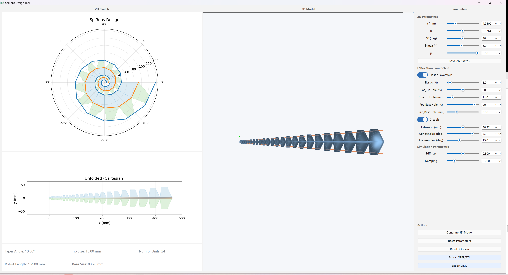
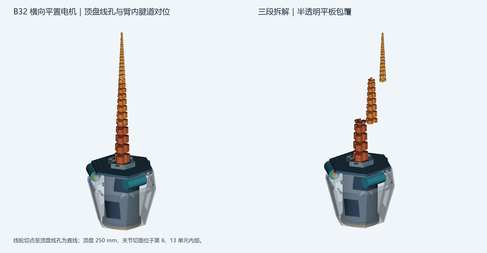

# Spiral Soft Arm 研究与工程验证仓库

本仓库基于 [Open Spiral Robots（OpenSpiRobs）](https://github.com/ZhanchiWang/Open-Spiral-Robots) 派生，保留其参数化设计工具，并继续整理本地 B32 三缆对数螺旋软体臂的几何、CAD、仿真、硬件布局和打印前验证工作。仓库由本地项目维护，不代表上游项目的官方版本或研究结论。

项目目前处于**设计与验证阶段**：有已归档的几何模型、仿真和 CAD 候选，但还没有完成整机打印、水下密封或负载任务验证。README 中把设计目标、数字检查、仿真结果和实物证据分开说明。

## 目录

- [项目目标与系统边界](#项目目标与系统边界)
- [B32 几何基线](#b32-几何基线)
- [机械与电子集成候选](#机械与电子集成候选)
- [仿真研究与当前结果](#仿真研究与当前结果)
- [项目模块和目录](#项目模块和目录)
- [安装与运行](#安装与运行)
- [验证状态与下一步](#验证状态与下一步)
- [候选版本和证据管理](#候选版本和证据管理)
- [上游来源、引用与许可](#上游来源引用与许可)

## 项目目标与系统边界

当前 B32 研究目标是构建一套三腱驱动的对数螺旋软体臂，并为淡水和海水环境中的抓取任务建立可追溯的几何、仿真、驱动和制造验证流程。以下是整机设计目标或当前布局假设，**不是已经通过的性能指标**：

| 需求 | 当前方案/假设 | 验证状态 |
| --- | --- | --- |
| 工作环境 | 淡水和海水；目标深度 5 m | 尚无压力舱、密封或水下运行验证 |
| 单次工作时间 | 约 30 分钟 | 尚无整机功耗、温升和续航实测 |
| 岸上供电 | 隔离 24 V 经水下线缆供电 | 电源、接插件、线缆压降和绝缘方案未完成实测 |
| 断电备份 | 岸上 24 V 中断后，内部电源继续运行至少 15 分钟 | UPS 切换、电池放电和带载时间未验证 |
| 执行器布局 | 三台电机置于湿侧，直接接触周围水体 | CAD 包络已建立；电机水下运行、腐蚀和温升未验证 |
| 控制与功率电子 | STM32 主控；电调和电池置于根部电子仓候选空间 | 尚无 STM32 固件和完成的控制板装配验证 |
| 电机候选 | ApisQueen 4092，优先评估配套 Mini ESC | 尚未完成单台样机测试；Mini ESC 电流、反馈、散热和接口资料不完整 |
| 电池候选 | 4 节 21700，每节 8000 mAh | CAD/能量估算暂按 4S1P；电芯型号、持续放电倍率、保护板和实际续航未核实 |
| 辅助输入 | Type‑C 模块接 UPS 输入，并预留升压/切换路径 | 还未完成电源路径、回灌保护和满载热设计验证 |

4S1P 的估算为 14.8 V 标称、8 Ah、约 118.4 Wh；串联不会把容量变成 32 Ah。电芯容量本身不能证明电池可提供电机启动或堵转所需电流，也不能证明可满足 15 分钟备份时间。相关硬件候选与待确认项见[电调与 STM32 接口记录](local/spiral-soft-arm/solidworks/electronics_enclosure_v3/电调硬件候选与STM32接口.md)和[4092 单台样机验证流程](local/spiral-soft-arm/hardware/4092_单台样机验证流程与记录模板.md)。

## B32 几何基线

B32 是本地论文构形和打印前研究的主要基线。当前参数记录给出的主体为一体式 TPU 95A 软体结构，包含离散对数螺旋轮廓、连续中央弹性轴和三条腱线通道；它不是由 32 个独立刚性关节组装成的机械臂。MuJoCo 中的刚体单元和等效关节用于降低阶模型分析，不能代替打印件的连续柔性力学。

| 参数 | 当前记录值 | 说明 |
| --- | ---: | --- |
| 螺旋单元数 | 32 | B32 候选标识中的 32 |
| 单元离散角步长 | 30° | 总离散角跨度为 960°，约 2.667 圈 |
| 螺旋增长系数 | `b = 0.13699` | 对数螺旋几何参数 |
| 截面参数 | `p = 0.5` | 本地轮廓插值参数，不是通常意义上的轴向螺距 |
| 名义主体长度 | 550.014 mm | 几何/STEP 记录值 |
| 参考基部直径 | 68 mm | 目标或参考尺寸；不等于最终实体包围盒宽度 |
| STEP 包围盒 | 66.656 × 59.500 × 550.014 mm | 导入回读的实体尺寸 |
| 尖端实际直径 | 7.359 mm | 当前基线几何值 |
| 腱线数量/方位 | 3 根，0° / 120° / 240° | 三路腱索围绕中心轴布置 |
| 弹性层 | 开启，名义占比 10% | 刚度参数仍需按实际打印材料标定 |

冻结参数、公式和适用范围详见[B32 几何参数](local/spiral-soft-arm/preprint/v2/B32几何参数.json)、[参数推导论文](local/spiral-soft-arm/preprint/v1/三缆软臂参数推导论文.md)和[论文构形几何验收记录](local/spiral-soft-arm/preprint/v2/reports/论文构形几何验收.json)。



*上图为上游设计工具界面示例；截图中的参数不是本地 B32 的冻结参数。*

## 机械与电子集成候选

### v9 根部总装候选

当前最新的根部结构候选保存在 [`electronics_enclosure_v9`](local/spiral-soft-arm/solidworks/electronics_enclosure_v9/)。该目录提供 STEP 总装、拆分件 STL、生成脚本、参数、几何审计和 SHA‑256 清单。

- 软臂分为三段；燕尾榫切面位于第 6 和第 13 关节单元内部，并用横向锁销代理定位。三段网格轴向长度约为 182.95、185.10、199.96 mm，低于项目提出的 250 mm 有效成型高度；打印方向、XY 占用、切片路径和实际装配还未核验。
- 顶盘为 250 mm 对角尺寸的六边形。含安装耳的审计包围盒约为 221.49 × 250 mm。
- 三台湿侧电机水平放置，轴线沿切向；三只线轮按切线方向出线。顶盘孔和机械臂入口在模型俯视图中对齐，线轮切点到顶盘孔的自由段建成直线代理。
- 外部平面包覆件由分片面板组成，留有电机检修窗和观察开口。外罩与水连通，属于防护/布局件，**不是压力壳，也不构成密封证明**。
- 电子仓和湿侧机构的模型空间已用于排布讨论，但电机真实轴端、线轮锁轴和绕线容量、接插件、线缆导向与密封边界仍未按实物冻结。



v9 的审计状态是“CAD 与预览候选”，并非打印或水下放行。模型还未建成线轮卷绕释放过程、完整圆滑导向和腱线进入臂内通道的可打印过渡结构；动态避让、燕尾疲劳、TPU 蠕变、锁销保持和细连接条强度均未通过实物验证。逐项说明见[v9 设计说明](local/spiral-soft-arm/solidworks/electronics_enclosure_v9/README_水平转位与线轮切线对孔.md)和[分段与装配几何审计](local/spiral-soft-arm/solidworks/electronics_enclosure_v9/分段与装配几何审计.json)。

### 电机、线轮、电子仓与供电

- **湿侧驱动**：当前研究重点是三台 ApisQueen 4092 低速减速电机及配套 Mini ESC。页面参数、转矩口径、连续电流、编码器/霍尔反馈、ESC 保护和物理外形仍需供应商书面资料和单台样机测量。这个组合是待验证候选，不是已确认的最终选型。
- **控制器**：系统方案采用 STM32 作为中央控制器，由各电调完成三相换相和本地功率保护。仓库目前没有 STM32 固件工程，因此尚未实现三轴闭环、限位、通信超时、故障锁定或急停逻辑。
- **UPS 与电池**：布局依据包括岸上隔离 24 V 输入、掉电备份、4S1P 电池估算和升压模块。电池实际放电能力、变换器效率、峰值功率、切换时间、再生制动回灌和 30 分钟任务能耗都尚未通过实测。
- **包覆与密封**：外部平板包覆件和内部密封电子仓是不同部件。外罩观察口用于检查/排水，不是压力平衡或承压结构的认证；电子仓也没有完成 5 m 压力和渗漏测试。

### 其他保留的机械候选

仓库保留多轮电机安装与电子仓布局，便于比较尺寸、走线和装配方式。`electronics_enclosure_v1` 至 `v8` 是设计迭代记录，v9 是目前最新的机械布局候选；早期版本不应和 v9 的尺寸或验证状态混用。`solidworks/user_3_0/` 是另一条一体式几何试验线，不能当作 B32 替代件。`solidworks/v2_rigid_links/` 是刚性连杆姿态模型，也不等同于连续 TPU 打印主体。

## 仿真研究与当前结果

水下 MuJoCo 研究通过 B32 基线建立 32 个刚体代理、31 个等效柔性关节、三路腱索和线轮约束，并加入浮力、目标物和现象学流体阻力。`local/spiral-soft-arm/simulation/v3/` 保存仿真脚本、输入配置和逐工况 CSV/JSON；`local/spiral-soft-arm/preprint/v4/` 保存当前较新的参数推导和评估报告。

当前 v4 报告覆盖淡水/海水、1 m/5 m 共四种工况：每种运行 8000 步且状态有限，但四种工况均未达到目标物抬升 5 mm 的任务门槛；候选搜索也没有发现通过全部门槛的可行设计。因此报告不宣称找到了成功的最优参数或合格驱动器。

仿真的关键边界：

- 1 m 与 5 m 运动工况使用相同运动学输入，水深压力作为元数据；压力没有耦合到外壳应力或形变。
- 流体作用是 MuJoCo 的简化模型，不是 CFD；模型未标定实际 TPU 曲线、腱索松弛/弹性、线轮多层绕线、真实电机电流环、密封和材料吸水。
- 使用理想化驱动参数或有限元之外的弹簧/阻尼刚体近似，不能据此证明实物抓取、材料强度、电机温升或水下安全。
- 目标物任务失败属于当前模型和参数范围内的负结果；不能通过单纯提高腱力上限推断实机性能会改善。

详细结论见[v4 水下驱动评估报告](local/spiral-soft-arm/preprint/v4/水下驱动评估报告.md)、[v4 参数推导论文](local/spiral-soft-arm/preprint/v4/B32水下驱动参数推导论文.md)和[逐工况仿真代码](local/spiral-soft-arm/simulation/v3/)。

## 项目模块和目录

| 目录 | 内容 | 当前说明 |
| --- | --- | --- |
| [`design-tool/`](design-tool/) | OpenSpiRobs Python 图形设计工具、螺旋几何模块、CAD/XML 导出和界面截图 | 用于交互式设计与导出；不代表本地 B32 已打印 |
| [`design-tool/blender/`](design-tool/blender/) | Blender 候选生成、几何检查、来源锁定与打样包构建脚本 | 包含 B32、B31、B33 等几何候选；候选比较不等于实物评估 |
| [`local/spiral-soft-arm/stage-a/`](local/spiral-soft-arm/stage-a/) | Blender 阶段 A 的候选 STL、检查脚本与结果 | 几何/拓扑阶段记录 |
| [`local/spiral-soft-arm/preprint/`](local/spiral-soft-arm/preprint/) | v1–v4 参数推导、预打印包、仿真说明和验证记录 | 各版研究边界不同，v2 打印门槛和 v4 水下驱动报告需分别阅读 |
| [`local/spiral-soft-arm/simulation/`](local/spiral-soft-arm/simulation/) | MuJoCo 模型、参数派生、工况运行、候选搜索、结果和图表 | v3 为四种水体/水深工况的主要脚本目录 |
| [`local/spiral-soft-arm/solidworks/`](local/spiral-soft-arm/solidworks/) | STEP/STL、CAD 生成脚本、预览、装配审计和哈希清单 | 保存论文构形、驱动安装、电子仓、包覆件及其他独立候选 |
| [`local/spiral-soft-arm/hardware/`](local/spiral-soft-arm/hardware/) | 湿侧电机验证流程和记录模板 | 模板尚未填写，不代表已采购或测试 |
| [`fabrication/`](fabrication/) | STEP/STP/STL 几何分割工具和制造说明 | 可切分并报告包围盒；目前不会自动添加燕尾、销钉或其他装配连接结构 |
| [`extensions/multi-robot-array/`](extensions/multi-robot-array/) | MuJoCo 多机器人阵列 XML 生成器与 PySide6 GUI | 与 B32 单臂打印放行无关的扩展工具 |
| [`rl/`](rl/) | PPO reach 检查点和演示视频 | 当前仓库未包含对应训练脚本、环境定义和评估记录，不能据此声称已复现实验 |
| [`datasets/`](datasets/) | 数据、标定文件和测试物体模型的存放目录 | README 目前为目录说明 |
| [`hardware/reference/`](hardware/reference/) | M2006/C610 供应商参考 CAD 与手册 | 保留供应商原版权和适用条款 |
| [`related-papers/`](related-papers/) | 参考论文 PDF 与书目信息 | 论文副本按其原始许可使用 |

### 关键文件索引

- [根部三段总装 STEP](local/spiral-soft-arm/solidworks/electronics_enclosure_v9/B32_三段机械臂_六边形包覆总装.step)
- [三段机械臂与燕尾接口 STEP](local/spiral-soft-arm/solidworks/electronics_enclosure_v9/B32_三段机械臂_燕尾榫装配.step)
- [v9 分件 STL 与生成脚本](local/spiral-soft-arm/solidworks/electronics_enclosure_v9/)
- [B32 论文构形 STEP/STL](local/spiral-soft-arm/solidworks/paper_v1/)
- [80 mm 基部和尖端 TPU 工艺短样](local/spiral-soft-arm/preprint/v2/process_coupons/)
- [当前打印放行条件](local/spiral-soft-arm/preprint/v2/当前状态与放行条件.md)
- [电机单台验证记录模板](local/spiral-soft-arm/hardware/4092_单台样机验证流程与记录模板.md)

## 安装与运行

不同模块依赖不同的 Python 包，建议分别建立虚拟环境。以下命令以 Windows PowerShell 为例。

### 运行设计工具

```powershell
cd design-tool
python -m venv .venv
.\.venv\Scripts\Activate.ps1
python -m pip install -r requirements.txt
python DesignTool.py
```

设计工具提供二维螺旋草图、参数调整、三维预览及 STEP/STL、MuJoCo XML 等导出功能。更详细的界面操作和截图见[`design-tool/README.md`](design-tool/README.md)。依赖版本和 Python 兼容说明以该目录的 `requirements.txt` 与 README 为准。

### 运行水下仿真

```powershell
cd local/spiral-soft-arm/simulation/v3
python -m venv .venv
.\.venv\Scripts\Activate.ps1
python -m pip install -r requirements.txt
python run_cases.py --output-dir results/reproduction
python sweep_candidates.py --output-dir results/search/reproduction
```

`run_cases.py` 运行淡水/海水 × 1 m/5 m 四工况；`sweep_candidates.py` 执行配置中的几何/驱动候选搜索和敏感性探针。输出是仿真结果，不是水下试验记录。当前锁定依赖见[`simulation/v3/requirements.txt`](local/spiral-soft-arm/simulation/v3/requirements.txt)。

### 使用制造分割器

```powershell
python fabrication/splitter_generator.py <模型.step或模型.stl> --axis z --max-span-mm 150
```

也可通过 `--cut-positions-mm` 指定切割位置，通过 `--build-volume-mm X,Y,Z` 检查分件包围盒。当前分割器执行几何切分，不负责连接件设计、结构强度或打印工艺认证。参数和输出格式见[`fabrication/README.md`](fabrication/README.md)。

### 使用多机器人阵列扩展

在具备 `mujoco` 和 `PySide6` 的 Python 环境中，从仓库根目录运行：

```powershell
python extensions/multi-robot-array/array_gui.py
```

该扩展以已有 MuJoCo XML 为输入，生成阵列 XML；参数说明和命令行入口见[`扩展 README`](extensions/multi-robot-array/README.md)。

## 验证状态与下一步

| 验证层级 | 当前记录 | 尚未证明的内容 |
| --- | --- | --- |
| 几何/CAD | B32 STEP 回读有效、单实体；STL 闭合。v9 总装和分段几何审计通过其静态检查 | 零件强度、装配公差、动态间隙、螺钉保持和长期疲劳 |
| 仿真 | v4 四种淡水/海水工况运行稳定，状态有限 | 5 mm 抬升任务失败；尚不能证明真实水动力、腱索或电机性能 |
| 切片 | 80 mm 基部/尖端短样有几何文件 | 未见供应商切片预览、实际打印批次和打印记录 |
| 材料/腱索 | TPU 95A 与三腱路线为当前研究基线 | 本批 TPU 拉伸/弯曲曲线、孔道摩擦、松弛、回差和疲劳未测 |
| 执行器/电控 | 4092、Mini ESC、STM32 和 UPS 进入布局/候选研究 | 未确认单台电机、Mini ESC 正式数据、电机电流/温升、反馈闭环和急停 |
| 负载任务 | 仿真目标为接触并保持目标物 | 当前 100 g 抓取保持未通过；实物台架任务尚未完成 |
| 防水/承压 | 5 m 淡水/海水和 30 分钟运行作为设计目标 | 无压力舱校核、渗漏、腐蚀、绝缘或全时长水下试验 |

建议的验证顺序是：检查 80 mm 短样切片并打印 → 测量尺寸、穿腱、低张力弯折与回弹 → 标定材料刚度和腱道摩擦 → 单台电机/电调测量转速、力矩、电流、温升和反馈 → 完成三路装配与动态绳路检查 → 台架抓取验证 → 通过结构审查后进行规定深度的压力与水下运行试验。每一阶段都应记录候选版本、源文件/模型哈希、材料批次、设备、参数、原始数据和结果。

当前打印边界详见[打印放行条件](local/spiral-soft-arm/preprint/v2/当前状态与放行条件.md)。v9 CAD 文件即使通过静态几何审计，也不等于“可直接打印”或“可下水”。

## 候选版本和证据管理

仓库包含多个几何和驱动候选，文件相似不表示它们是同一版本：

- **B32 论文构形**：当前 550 mm 三腱主体基线；与其配套的 STEP/STL 和几何验收单独存档。
- **Stage A 候选**：Blender 参数探索得到的 A/B 系列几何候选，主要用于比较轮廓和几何门槛。
- **用户 3.0 候选**：独立的一体化几何试验，不是 B32 的尺寸或验证证据。
- **刚性连杆姿态候选**：用于姿态表达/机构比较，不代表连续 TPU 结构的真实变形。
- **电子仓 v1–v9**：根部驱动、线轮、外罩和分段方案的迭代；当前审阅焦点为 v9。
- **MuJoCo 刚体模型**：用于机制与参数分析的降阶模型；其中的单元碰撞 STL 不是打印零件。

本项目使用分阶段证据门槛：**几何检查 → 切片检查 → 短样打印 → 腱线与无负载运动 → 抓取/负载测试 → 水下与压力测试**。网格闭合、STEP 可读、仿真状态有限或图片外观正常，都不能单独证明零件可打印、机构可动、负载可抓取或整机防水。

## 上游来源、引用与许可

设计工具和研究基础来自 [Zhanchi Wang 的 Open-Spiral-Robots](https://github.com/ZhanchiWang/Open-Spiral-Robots)。使用上游工作时请保留归属并按上游项目页面要求引用：

```bibtex
@software{wang_openspirob,
  title        = {OpenSpiRobs: Open Spiral Robots Toolkit},
  author       = {Wang, Zhanchi},
  year         = {2026},
  url          = {https://github.com/ZhanchiWang/Open-Spiral-Robots}
}
```

本仓库适用根目录 [`LICENSE`](LICENSE) 中的 **PolyForm Noncommercial License 1.0.0**；商业用途需按许可条款另行取得许可。`design-tool/LICENSE` 也保留上游许可。

第三方材料不因根目录许可证而改变原有条款：[`related-papers/`](related-papers/) 中未修改的论文副本采用 CC BY-NC-ND 4.0；[`hardware/reference/`](hardware/reference/) 中的供应商 STEP 和手册保留各自版权和使用条件。复用这些文件前请查看对应目录说明。
