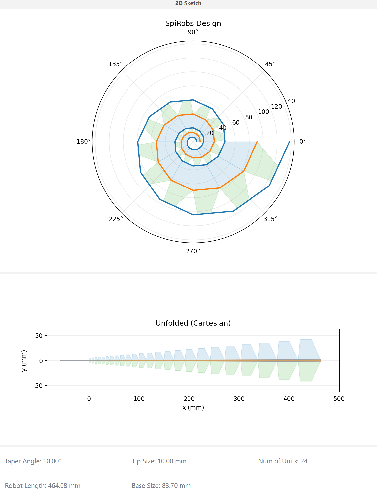
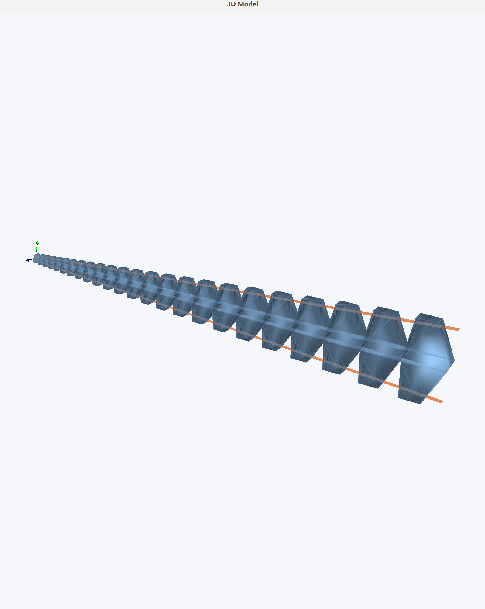
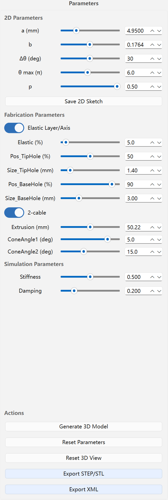

# OpenSpiRobs 设计工具

用于设计对数螺旋软体机器人（双缆/三缆）的图形界面工具，可导出 CAD 文件（STEP/STL）和 MuJoCo XML 模型。

## 许可证

- SPDX：PolyForm-Noncommercial-1.0.0
- 商业使用需要单独取得许可。

## 环境要求

- Python 3.10 或更高版本
- 已在 Python 3.10 和 3.11 上测试
- Python 3.13 需要使用 `requirements.txt` 选择的新版本 `vtk` wheel
- 依赖列表见 `requirements.txt`

安装依赖：

```bash
python -m pip install -r requirements.txt
```

## 启动

```bash
python DesignTool.py
```

---

# 使用指南

## 1）快速开始

1. 打开终端并进入工具目录（替换为本机路径）：

```bash
cd "<本仓库下载路径>/design-tool"
```

2. 创建并启用虚拟环境（推荐）；如果已有虚拟环境，可跳过：

```bash
python -m venv .venv
.\.venv\Scripts\Activate.ps1
```

3. 安装依赖：

```bash
python -m pip install -r requirements.txt
```

4. 启动程序：

```bash
python DesignTool.py
```

5. 手动检查二维/三维视图：
   - 左侧面板显示二维草图。
   - 拖动右侧滑块，确认草图随参数变化更新。
   - 点击 **Generate 3D Model**，确认三维视图成功显示模型。

6. 检查导出功能：
   - **Save 2D Sketch** → 应生成 PNG/PDF 文件。
   - **Export STEP/STL** → 应生成 STEP/STL 文件。
   - **Export XML** → `exports/` 中应包含 `robot.xml` 和 `baselink.stl`。

7. 快速核验导出结果：
   检查 `exports/` 下最新生成的目录，确认其中包含：
   - `baselink.stl`
   - `robot.xml`
   - STEP/STL 文件

## 2）界面截图






---

# 致谢

感谢 [Haobo Yang](https://github.com/yhbcode000)、MBZUAI 的 [Ke Wu](https://mbzuai.ac.ae/study/faculty/ke-wu/) 及其团队开发参数可视化系统 [SpiRobs](https://aierlab.tech/SpiRobs/)，本项目受该系统启发。
