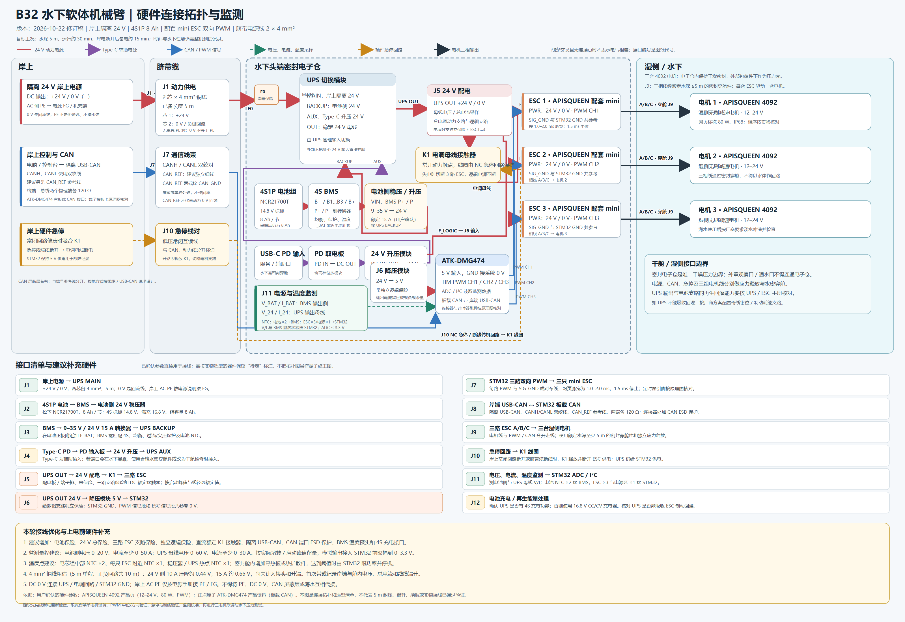

# B32 硬件拓扑与接口补充清单

**修订日期：** 2026-10-22

**状态：** 按用户确认的硬件参数整理；拓扑可用于接线评审，实物引脚、保护器件额定值和水下验证仍需逐项确认。

## 已确定的系统参数

| 项目 | 当前采用值 |
|---|---|
| 岸上供电 | 隔离 24 V DC，经脐带缆输入 UPS 主输入 |
| 岸电输出导体 | +24 V 与 0 V/− 两芯；每芯 4 mm²，已备长度 5 m |
| 保护地 | 岸上交流输入侧按电源手册将 PE 接电源 FG / 机壳端；不把 PE 当作 24 V 回流线 |
| 电池 | 4S1P 松下 NCR21700T；每节 8 Ah；电池组容量仍为 8 Ah |
| 电池电压 | 3.7 V/节标称；4S 标称 14.8 V，满充 16.8 V |
| 电池侧稳压 | BMS 后 9–35 V 输入，24 V 输出，额定 15 A |
| UPS 输入 | 岸电 24 V 为 MAIN；电池侧 24 V 为 BACKUP；Type-C 升压 24 V 为 AUX |
| 主控供电 | UPS OUT 24 V 经独立 24→5 V 降压模块供 STM32 |
| 控制器 | 正点原子 ATK-DMG474，STM32G474VET6；实际计时器、ADC、CAN 端子按对应板卡原理图映射 |
| 执行器 | 3 台 APISQUEEN 4092；每台配 1 个 mini ESC；配套 ESC 控制为双向 PWM |
| PWM 中位与方向 | 产品页所列脉宽为 1.0–1.5 ms 反转、1.5 ms 停止、1.5–2.0 ms 正转；刷新率和上电状态按实物说明书确认 |
| 目标工况 | 5 m 水深、约 30 min 运行、岸电断开后约 15 min 备电，须由样机测试记录 |

## 电源连接

    岸上交流 L / N ──> 隔离 24 V 电源
    岸上交流 PE ─────> 电源 FG / 机壳接地点（按该电源说明）

    电源 +24 V ── 4 mm² 脐带缆 ──> F0 ──> UPS MAIN+
    电源 0 V / − ─ 4 mm² 脐带缆 ──> UPS MAIN− / 0 V

    4S1P 电池 ──> 4S BMS ──> 9–35 V / 24 V 稳压器 ──> UPS BACKUP
    Type-C PD ──> PD 输入板 ──> 24 V 升压器 ──> UPS AUX
    UPS OUT ──> 24 V 配电板
                  ├──> K1 直流接触器 ──> F_ESC1 / F_ESC2 / F_ESC3 ──> 三只 ESC
                  └──> F_LOGIC ──> 24→5 V 降压 ──> STM32

- 电源输出只有 +24 V 与 0 V/− 时，0 V/− 就是负载电流回路，接 UPS MAIN 的负极。
- PE 是交流侧的保护导体。它与 DC 0 V 是否在电源内部相连，取决于具体电源；除非产品手册要求，不要自行将 0 V 接 PE、机体或水体。MEAN WELL 的说明也指出，AC 侧 FG 与 DC 输出 −V/COM 是不同节点，但部分型号可能存在内部电容连接或短接，因此以实际电源规格为准。
- STM32 GND、PWM 信号地与 ESC 的逻辑参考地共用本机 DC 0 V。不要让屏蔽层或海水承载电流。
- UPS 是多路输入的切换模块；岸电、BACKUP、AUX 不应在模块外直接并联。按已选 UPS 手册的端子名称与切换方式连接。
- 电池正极附近设置电池保险；UPS 输出配总保险；三只 ESC 分别设置支路保险；STM32 降压支路单独设置逻辑保险。
- Type-C 输入属于辅助电源。裸露 Type-C 口只用于干燥环境或检修状态；若水下仍需接入，改用有适当压力等级的水密穿舱连接器。

## PWM、CAN 与急停

### 三路 PWM

- STM32 用三个独立定时器 PWM 输出分别控制 ESC 1、ESC 2、ESC 3。
- 每路信号与 SIG_GND 成对走线，三相电机线与 PWM/CAN 线分开布置。
- PWM 的具体 MCU 引脚按 ATK-DMG474 当前板卡原理图与引脚复用表确定；不要仅凭芯片引脚候选直接布线。
- 核对 ESC 输入高电平阈值、输入阻抗、刷新率和失控默认状态。若 3.3 V 输出不满足输入电平要求，再加入合适的缓冲/电平转换；不要预先假设板载接口可直接驱动。
- 设置上电中位、PWM 超时停机、复位默认停机、限速/限位和看门狗故障处理。若 ESC 提供 BEC 5 V，除非手册明确要求，不将其并接 STM32 的 5 V 电源。

### 岸上 CAN

- 岸端使用隔离 USB-CAN 适配器，CANH/CANL 通过独立双绞对连接到头端 ATK-DMG474 的板载 CAN 接口。
- 电机驱动是高噪声环境；建议在脐带线束中再加一根细的 CAN_REF，两端分别接 CAN 收发器的总线侧 CAN_GND。水下端接 ATK-DMG474 的 CAN 参考地；岸端使用隔离 USB-CAN，CAN_REF 接适配器的隔离总线侧参考端，不接电脑地或 PE。若线缆有屏蔽层，屏蔽层按接口和 EMC 方案单独处理，不能代替 CAN_REF 或 0 V 动力回路。
- 120 Ω 终端只在 CAN 总线两个物理端各放一只。若 USB-CAN 或开发板已内置终端，应按实际跳帽/开关状态调整，避免重复终端。
- 在电缆入口附近预留 CAN ESD/浪涌保护器件焊位；是否装配和器件等级按线缆长度与试验结果确定。

TI 的隔离 CAN 指南指出：差分 CANH/CANL 在共模范围满足时可仅用两线连接；在噪声系统中建议使用第三根参考线。其指南也建议将屏蔽层接地方式按单点方案设计，以避免地环路。

### 硬件急停

- 建议使用岸上常闭（NC）急停回路控制 K1 线圈。健康状态保持接触器吸合；按下急停、控制线断开或脐带缆断线时，接触器释放并切断三路 ESC 的 24 V 支路。
- K1 的动力触点要按 24 V DC 与实测电流/浪涌选型。急停切断电机母线，UPS 仍给 STM32 供电，以便记录故障和电池状态。
- CAN 命令急停可作为软件冗余，但不能代替上述硬接线回路。

## 电压、电流与温度监测

| 测量点 | 位置 / 建议量程 | 接到主控 |
|---|---|---|
| 电池组电压 V_BAT | BMS 输出端；0–20 V | STM32 ADC，经分压和输入保护 |
| 电池组电流 I_BAT | BMS P+ 输出至 24 V 转换器之间；建议 0–50 A 量程 | Hall 或分流器监测模块；模拟输出或 I²C |
| UPS 母线电压 V_24 | UPS OUT / 配电板输入；建议 0–60 V | STM32 ADC 或总线监测模块 |
| 电机母线总电流 I_24 | UPS OUT 到 ESC 支路分流前；建议至少 0–30 A 量程 | Hall 或分流器监测模块；保留峰值记录 |
| 电池温度 | 电池组内部两端或中心附近 NTC ×2，接 BMS 温度输入 | BMS 硬件保护；可将温度状态回传 STM32 |
| ESC 温度 | 每只 ESC 附近 NTC ×1，共 3 点 | STM32 ADC 或多通道温度采集 |
| 电源模块温度 | 稳压器 / UPS 热点附近 NTC ×1 | STM32 ADC；超温限功率或停机 |

量程是拓扑设计建议，采购时要覆盖启动、堵转和制动工况的峰值；所有直接进 STM32 ADC 的模拟输入须限制在 0–3.3 V，并加适当分压、滤波和过压保护。若 BMS 已提供准确的电压、电流和温度通信数据，可优先读取其遥测，再保留独立母线电流测量用于电机负载统计。

### 电源线压降粗估

按铜线电阻率约 0.0175 Ω·mm²/m，4 mm²、5 m 单程（正负回路合计约 10 m）：

| 24 V 侧电流 | 回路压降估算 | 线缆发热估算 |
|---:|---:|---:|
| 10 A | 约 0.44 V | 约 4.4 W |
| 15 A | 约 0.66 V | 约 9.8 W |

该估算未计连接器接触电阻、线缆温升和弯折处损耗。首次带载时记录岸端电压、舱内 UPS MAIN 电压、实际电流和线缆温升；如果电流接近 15 A，尤其要核对线束端子、保险座和连接器额定电流。

## 上电前建议补充的硬件

| 优先级 | 硬件 | 用途 / 选型条件 |
|---|---|---|
| 必须 | 4S BMS | 支持 4S 锂电池、单体均衡、过流/短路/欠压保护和电池温度输入；连续电流覆盖转换器输入电流 |
| 必须 | 电池保险、总保险、3 路 ESC 支路保险、逻辑保险 | 保护电芯、线束、配电板与 STM32 电源；按实际峰值和线材能力协调选型 |
| 必须 | DC 额定 K1 接触器和常闭急停线对 | 不依赖 CAN，在岸电消失或通信丢失时仍能切断电机动力支路 |
| 必须 | 24→5 V DC/DC | UPS OUT 到 STM32；额定输入覆盖 UPS 输出，5 V 电流留有板载负载裕量 |
| 必须 | 水密穿舱件、线缆应力释放和锁紧件 | 电源、CAN、急停及三组电机相线分路穿舱；额定水深高于 5 m 并留有余量 |
| 必须 | 电池充电路径 | 若所选 UPS 不带匹配 4S 充电器，补 16.8 V CC/CV 充电器与 BMS 规定的充电端口 |
| 本轮新增 | 电池侧 V/I 监测模块 | 量程建议 0–20 V、0–50 A；霍尔型可减少测量电路与高电流路径的直接耦合 |
| 本轮新增 | UPS 母线 V/I 监测模块 | 量程建议 0–60 V、至少 0–30 A；记录总负载、起动峰值和电压跌落 |
| 本轮新增 | NTC 温度探头 | 电池 ×2、ESC ×3、电源模块 ×1；测点贴合被测器件并做绝缘固定 |
| 建议 | 隔离 USB-CAN、CAN 终端、CAN_REF、CAN ESD 保护 | 岸上控制与水下主控通信，改善电机噪声环境下的鲁棒性 |
| 建议 | 电源热扩散件 | 将 24 V 转换器、UPS 和 ESC 产生的热量扩散到设计好的热路径；密封舱不能依赖对外通风 |
| 待确认 | 再生能量钳位 / 制动耗能模块 | 先确认 ESC 的制动回灌路径和 UPS 输出是否能吸收；若不支持，按模块厂商推荐方案加装 |

## 建议的验证顺序

1. 断电检查电池极性、BMS 端子、保险方向、UPS MAIN/BACKUP/AUX/OUT 端子和 DC 0 V 连通关系。
2. 分别验证岸电供电、备电供电和 UPS 切换；测量 24 V 母线和 5 V 逻辑电源。
3. 单只 ESC 接限流电源，先验证 PWM 中位、正反转方向、上电默认状态和失联停机。
4. 校准电池与 24 V 母线的电压/电流采样，比较 NTC 读数与参考温度计。
5. 验证常闭急停、急停线断开、CAN 断线、STM32 复位和低电压保护；急停时确认 ESC 断电而主控继续供电。
6. 单台电机空载运行，再逐步带载；记录电流、母线电压、UPS 切换和所有温度点。
7. 三台联调后完成约 30 min 干舱热测试，再安排 5 m 压力与淡水/海水试验。当前图纸和本清单均不代表这些测试已经通过。

## 资料来源

- [APISQUEEN 4092 产品页](https://www.waterproofmotor.com/products/apisqueen-12-24v-0-200rpm-4092-ip68-brushless-dc-waterproof-motor-gear-motor-for-rov-boat-underwater-thruster)：电机参数及配套 mini ESC 的 PWM 脉宽说明。
- [正点原子 ATK-DMG474 产品资料](https://www.stmcu.com.cn/hardwaredevelopmenttools/2878)：板卡外形、STM32G474VET6 和 CAN 接口信息。
- [MEAN WELL 接线说明](https://configurable.meanwell.com/qa.aspx)：交流输入 FG 与直流输出 −V/COM 的区分及按具体型号核对的提醒。
- [TI 隔离 CAN 设计指南](https://www.ti.com/lit/an/slla486c/slla486c.pdf)：总线参考线、共模范围和屏蔽层单点处理说明。
