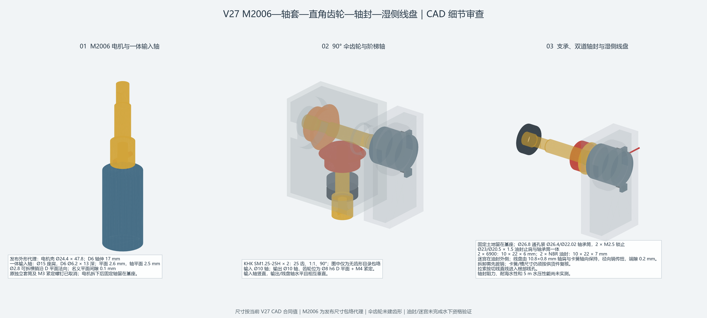
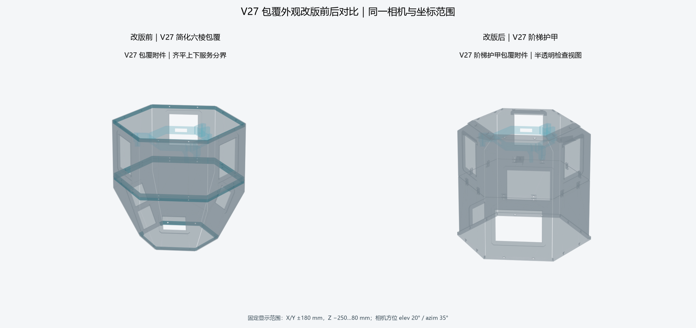

# V27：1 m 四段臂体与 M2006 模块化总装候选

本目录保存 `V27-1M-M2006` 静态 CAD 与工程计算候选。它在不覆盖 V26 的前提下，将臂体名义长度改为 1,000 mm、42 个离散单元和四个打印分段，并把可更换边界明确分成两种：整根四段臂体模块从根部更换；三台 M2006 连同共同安装板作为一个驱动模块更换。固定轴承、干侧直角齿轮仓、水平输出轴、双侧轴封/迷宫和湿侧线轮固定在基座上，不随电机板拆走。

当前状态是可追溯的几何、装配和初步计算候选，不是打印或下水放行版本。

## 论文螺旋参数与 5 m 环境边界

V27 的连续螺旋不再把论文示例 `Δθ=30°` 当成固定值。生成器由论文中心线长度方程和根尖尺寸比 `120/5=24` 数值反求 `b`，得到 `b=0.140222015932`、`a=3.537542594481 mm`、`a1=6.037542594481 mm`、`θ0=22.664442592811 rad`。42 个离散四边形各对应一个角度区间，故 `Δθ=θ0/42=30.918497752014°`，相邻单元比例 `β=exp(bΔθ)=1.078604362321`。每个 Z 向单元跨度由中心线弧长函数 `s(θ)=sqrt(1+b²)·a1/b·(exp(bθ)-1)` 的相邻边界差生成，42 段合计 1,000 mm。

水深不进入对数螺旋参数。按淡水 `ρ=1000 kg/m³`、海水 `ρ=1025 kg/m³`、`g=9.80665 m/s²` 的估算，5 m 表压分别约 `49.03 kPa` 和 `50.26 kPa`。这只是环境压力背景；本参数推导不证明 TPU 臂体、燕尾连接、密封或整机通过 5 m 压力试验。完整推导见本目录中的 Markdown 与 Word 报告，精确数值见 `V27螺旋参数.json`。

## 设计合同

| 项目 | V27 合同值 | 当前证据 |
| --- | ---: | --- |
| 臂体名义长度 | 1,000 mm | 参数合同和 CAD 包围盒检查 |
| 离散单元 | 42 | 单元边界测试 |
| 打印分段 | 4 段，成形高度约 249.7–263.9 mm | 目标打印机 Z 有效高度 320 mm；含榫后仍低于 300 mm 合同限值 |
| 拉索 | 3 路，0° / 120° / 240°，0.5 mm UHMWPE 候选 | 连续采样中心线与三维对齐测试 |
| 根部快换 | Ø180 mm 最大法兰、Ø130 × 5 mm 止口、2 个非对称 Ø6 定位销、6 个 M5 | CAD 代理和工具空间测试 |
| 顶盘 | 250 mm 对角六边形 | STEP 与包围盒检查 |
| 驱动 | 3 台 DJI RoboMaster M2006 P36，共同可拆安装板 | 官方 STEP 来源哈希；安装态使用 Ø24.4 × 64.8 mm 发布外形代理 |
| 固定轴系 | 每路一对 KHK SM1.25-25H 直角伞齿轮（1:1），Ø10 mm 输出轴在齿轮处阶梯至 Ø8 mm D 平面；双侧 6900 轴承、TRP000100 油封、迷宫与湿侧线轮 | 齿轮按目录尺寸建立无齿形包络；H 型表面耐久许用转矩 1.35 N·m，对比 M2006 连续最大 1.0 N·m 余量有限；啮合/寿命与轴强度未验证 |
| 根部包覆附件 | 6 片上板 + 6 片下部服务板；两道外凸六边形环带分成平面肋条并与面板一体打印；两处 110 × 80 mm 大观察口；单件根部短护圈 | 面板名义轮廓 Ø324 mm，含肋条最大径向 Ø332 mm，装配包围盒 332 × 287.52 × 300 mm；350 mm 平台每侧名义余量 9 mm；48 个 M3 Ø3.4 mm 孔（切向 ±35 mm），24 个内侧局部支撑垫；所有孔位 Ø8 × 2.1 mm 浅沉孔；紧固接收方式尚未建模；下部六片服务板可逐块径向取出，全部拆除后驱动板负 Z 路径通过；外水连通、不承压 |
| 电调 | 3 只 C610 固定在电子/控制侧 | 按官方 50 × 22 × 7.3 mm 外包络代理；不属于可拆 M2006 电机板 |
| 环境目标 | 淡水/海水，5 m，30 分钟，低速 1 kg 任务 | 目标值；尚无物理验证 |

## 三个机械模块及固定边界

### A. 整根四段臂体模块

四段打印件的切面都切入原有关节单元内部：第 5、10 单元的切面分别为 Z=249.780、501.635 mm；第 18 单元切面为 Z=744.343 mm（相对该单元中心面向根部偏移 6 mm，以避免末段切面后形成断开的软臂实体）。相邻打印段共享切开的原单元剖面，下段榫头沿 +Z 伸入上段 12 mm，上段卯口深 12.3 mm。燕尾截面底宽 10 mm、顶宽 14 mm、高 8 mm，绕 Z 旋转 8°；按真实截面法向外扩生成卯口，单边配合间隙 0.30 mm。每个接头在切面 +6 mm 处设 Ø3.3 mm 横孔，配 Ø3 mm 可拆金属锁销，轴线位于 XY 平面 30° 方位；60° 会与 240° 拉索孔共线。生成后几何核对的榫头/拉索孔最小净距分别约 17.770、9.852、2.478 mm，锁销/拉索孔最小净距约 10.405、6.423、2.585 mm。最窄候选净距仍需用实际线径、材料和打印收缩试样复核，不能视作强度裕量。

四段主体 Z 区间为 0–249.780、249.780–501.635、501.635–744.343、744.343–1000 mm；切面切进关节单元 5、10、18。含 12 mm 榫头后的实际打印高度分别为 261.780、263.855、254.708、255.657 mm，最高段低于 300 mm V27 限值和 320 mm 打印机有效 Z 高度。相邻段在装配中有 12 mm 轴向咬合，横向锁销阻止轴向退出。四段装好后作为一根完整臂体，通过根部止口、非对称定位销和六个 M5 紧固点连接固定基座。三路拉索端头使用不同键码，另有二次保持代理，降低换装时接错路线的风险。

臂体正 Z 连续抽出扫掠已按整组零件验证：先卸载并断开三路拉索端头，拆下固定六边形根部护圈和六个 M5 根部螺栓；其余侧面包覆板留在原位。模型计算抽出行程 69.5 mm、名义最小间隙约 0.10 mm、未发现与固定基座/驱动/电子件的扫掠相交。0.10 mm 只是理想 CAD 净距，仍需按实际打印公差做样件验证。

### B. 三台 M2006 整板驱动模块

三台 M2006、共同电机板、电机托环和板侧定位结构属于可拆驱动模块；电机轴线竖直，安装板可沿负 Z 方向整体退出。每路固定输入轴将 M2006 D6 插座、Ø15 mm 横销座肩、竖直轴和 Ø8 mm 齿轮轴颈合为一件，三只轴固定在基座上并伸入干侧齿轮仓。插座按官方 Ø6 mm 轴截面制作 D 形孔：官方 STEP 截面测得 D 平面距轴心约 2.5 mm，插座平面设在 2.6 mm，名义平面间隙 0.1 mm；Ø2.8 mm 横销与 D 面法向同向，穿过电机轴横孔以限制轴向分离并提供冗余止转；当前 CAD 仅建模横销圆柱，未选择或建模横销自身的正向防脱件，不能视为已可靠防脱，CNC 加工前须确定保持方式并核对工具操作空间。齿轮已经选为每路一对 KHK SM1.25-25H（25 齿、模数 1.25、1:1、轴交角 90°），三路合计 6 只。模型按目录外径 Ø33.02、轮毂 Ø25、齿宽 7、总长 17.88 mm 建立尺寸包络，未导入齿形。竖直输入转为沿本路切向的水平输出轴，因此线盘轴与电机轴垂直。安装板中心服务孔半径 82 mm；定位环与安装板融合为一个部件，定位环内/外半径分别为 80/82.25 mm，与固定座 82.5–82.75 mm 的环形座配合。该开口按电子仓 Ø150 mm 底盖和 M12 Type-C 外侧包络布置。两枚 Ø6 mm 定位销位于半径 90 mm、17°/157°，穿板孔 Ø8.2 mm；固定销套的内/外半径分别为 3.25/3.75 mm，使销与孔壁以及移动板孔与销套均保留至少 0.25 mm 的径向净距。M2006 官方轴图给出 D6 轴伸出 17±0.30 mm、Ø3 横孔中心距轴端 9 mm；电机 D6 轴插入一体输入轴 13 mm，配 Ø2.8 可拆横销；独立联轴套和 M3 紧定螺钉已取消。换电机板时先断电并卸载拉索，拆 24 颗下部外罩 M3 螺钉，分别沿径向取下 `fixed_cover_lower_panel_01…06`，不需要拆环带；六块上板和对应肋条留在原位。逐块取板的几何路径以 120 mm、1 mm 步进进行位置采样检查。随后断开线束、拔出三只横销，再沿负 Z 抽出 280 mm。修正后的驱动模块连续扫掠无碰撞，最近代理净距约 0.10 mm；该名义净距未计入加工公差、线束柔性和真实齿轮退啮。固定轴、齿轮、水平输出轴和线盘留在基座。此几何路径还需验证真实公差、线束柔性、齿轮退啮和人工拆装。

这次复核的官方 M2006 STEP 有 35 个开放曲面壳、没有闭合实体，且整体文件包含爆炸分散零件，故不能直接作为实体干涉模型。官方使用说明书给出整体长度 64.8 mm、D6 输出轴直径 6 mm、轴伸出 17±0.30 mm、Ø3 横孔中心距轴端 9 mm和轴向 M3 螺纹孔深 5.5 mm。官方 STEP 的 D 形截面测得平面距轴心约 2.5 mm；模型将电机显示轴代理改为对应的 D6 外形，并使径向横销沿 D 平面法向穿过。电机显示包络采用 Ø24.4 × 47.8 mm 外壳候选和 D6 × 17 mm 输出轴代理；一体输入轴为 Ø6.2 mm × 13 mm D 形插座，插座平面距轴心 2.6 mm，Ø3.2 mm 横孔配可拆 Ø2.8 mm 横销。插座圆周/平面间隙名义各 0.1 mm；此为 CAD 名义接口，不是最终 CNC 公差。Ø15 mm 座肩在第一输入轴承前留 0.2 mm 名义轴向间隙，Ø10 mm 轴段继续穿过两只轴承。轴为 316L CNC 加工候选；实物轴端孔位、钟向、插拔间隙、横销操作空间和材料强度仍需复核。官方 STEP 仍是开放曲面，安装态采用说明书尺寸和接口代理；到货后复核轴孔钟向、轴伸公差、横销操作空间与线束方向。具体尺寸与依据见 `preprint_review/V27打印前审查.md`。

### C. 固定传动、密封和湿侧基座

**固定密封边界**：可拆电机板上方为干侧直角传动舱；固定轴、轴承座、轴封座与湿侧线盘留在基座。输出轴穿越干湿界面处由两只油封和外侧迷宫分隔，线盘位于双密封之间并可接触水。此为待加工与压力试验验证的设计边界，不是已验证的水密结论。

每路线盘轴向为水平切向 `T=(-sinθ, cosθ, 0)`，电机/输入轴向为竖直 `Z=(0,0,1)`，两轴点积为 0。线盘位于 250 mm 六边形顶盘上方，卷芯中心高于顶盘；拉索从卷芯下侧切点出线，切点高度与根部入口一致，沿径向直线进入线孔，再由根部曲面通道接入原腱道。顶盘线盘区没有大开槽。实际圆柱面半径、0.5 mm 拉索半径和模型接触点共同参与切点审计；三路的接触面距离误差均为 0 mm，线孔横向偏差均为 0 mm。

干侧直角传动采用 KHK SM1.25-25H 目录尺寸的无齿形包络代理；竖直输入与水平输出轴交角 90°、传动比 1:1，输出齿轮通过 Ø8 mm 齿轮轴颈驱动 Ø10 mm 316L 候选轴。齿轮座孔为 Ø8 mm，轴在齿轮位置阶梯至 Ø8 h6 并加工 D 平面，轴封及线轮工作段保持 Ø10 mm 圆轴。每路含两只竖向输入 6900 轴承和两只水平输出 6900（10 × 22 × 6 mm）轴承；输出支承分别在齿轮侧和线盘远侧，当前轴向中心间距约 74.5 mm。两端各有 Trelleborg TRP000100（10 × 22 × 7 mm，NBR，目录压力上限 0.5 MPa）油封候选，外侧各有迷宫代理。三路线盘位于两道密封之间，设计为湿侧件；干侧伞齿轮仓及两端轴承仓固定于基座。轴承间距、输出轴悬伸段挠度、齿轮反力和密封摩擦尚待实物尺寸与载荷核算；目录压力等级不等于此结构已通过 5 m 旋转密封试验。油封不能充当轴承。

湿侧线盘仍是独立可换件，改用 Ø10.1 mm 圆形通孔和卷芯内的 Ø2.5 mm 可拔径向驱动销传扭；拔销后线盘可沿 Ø10 mm 圆轴及密封段滑移。该孔对 Ø10 mm 轴只有 0.10 mm 直径间隙（单边 0.05 mm）；CAD 名义扫掠通过不等于打印后一定能滑配。打印收缩、孔椭圆度、表面纹理和湿态污染都可能让线盘变紧，整臂打印前必须先做孔轴配合短样，必要时扩孔或后加工。轴上增加 Ø10.8 × 0.8 mm 一体内侧止肩，并在外侧加工 Ø9.6 × 1.0 mm 卡簧槽，配 Ø16 mm 外径的卡簧几何包络；线盘两端各留 0.2 mm 名义轴向间隙。卡簧型号、槽公差与保持力需按实际供应件和轴材料确认。三只线盘、输入/输出轴、轴承、轴封和齿轮仓均留在基座，电机板拆除时不随板移走。

### D. 根部电子仓

V27 复用 V25 命名的筒体、下盖和硬件支架几何：筒体外径 136 mm、内径 126 mm，主体 Z 范围 −230 至 −20 mm；下盖保留 M28 凹台和面板开孔，筒壁保留 M12 Type-C 安装位。电子仓内部包括 4 节 21700 电芯与托架、STM32F407ZGT6 板和背板/导轨、100×80×39 mm 电池侧稳压器、100×50×15 mm UPS、PD1002、理想二极管、4S40A BMS 包络、42×24×5 mm 降压模块与支架，以及 M28 插座/插头代理。电池侧稳压器和给 STM32 供电的降压模块是两个不同模块，本版本都保留。

三只 V24 C620 包络已排除；三只 C610 控制器与背板留在干侧控制空间，不随 M2006 驱动板拆走。官方 C610 STEP 的非长线束组件簇包围盒约为 49.67 × 22.14 × 6.90 mm，官方产品页标称外形为 50 × 22 × 7.3 mm；旧 V27 代理长度为 44.8 mm，少计了连接器外伸。本版本将三只 C610 外包络改为 50 × 22 × 7.3 mm，保留 48.8 mm 背板；延长到 54 mm 的背板代理会与电子仓筒体相交，因此不采用该延长。50 mm 外包络在当前三处位置的全装配预检无禁止碰撞，但连接器朝向、尾线弯曲和实物固定方式仍要核对。

为让干净检出也能稳定重建，V27 不再运行 V25 上游脚本依赖链，而是读取仓库根目录 `v27_electronics_snapshot/` 中冻结的 31 个电子件 STEP 与 1 个服务净空 STEP，并逐件核 SHA‑256、单实体和有效性。快照保留 V25 的 7 mm 上层布置、M28 底盖凹台、M12 壁面接口以及源拟合审计；来源与适配记录在快照 JSON 内。V27 对电子硬件作了几何适配：21700 电芯与托架相对 V25 坐标再下移 3 mm、向 +X 移 1.5 mm；UPS、背板和下托轨整体向 +X 移 2 mm；带让位槽的电芯底托与托架合为一个打印件，三块竖向背板分别与原下托轨融合。M28 插座主体和内侧法兰合并为一个连接器包络，避免将同一连接器的夹持/安装交叠误判为两个独立零件冲突。三块 C610 按本地径向位置仅旋转一次。旧电子仓三处 Ø14 mm 电机线束凸台被保留，驱动仓内环则在对应方位开 Ø15 mm 径向让位孔。

V25 冻结审计记录的硬件、筒壁、降压模块及 M28 体积交叠均为 0。V27 当前重建后禁止碰撞、驱动拆卸扫掠、三路拉索根部路线和线束探针均无命中；整板移除不带走固定传动件。碰撞阈值为 0.02 mm³，齿轮使用目录尺寸包络而非真实齿形。线盘轴与电机轴互相垂直、线盘真实圆柱面的切点到根部线孔为直线，均有专门回归测试。齿轮啮合、承载寿命、输出轴强度、真实轴承配合、BMS 壳体、M12/M28 密封件、线束弯曲半径/O形圈压缩率和筒体 5 m 耐压仍未验证。

## 本轮传动、轴封与包覆复核

### 齿轮确定

本版本采用 **KHK SM1.25-25H 伞齿轮，每路一对、三路共 6 只**。规格为 25 齿、模数 1.25、90° 轴交角、1:1 传动比；目录外径 Ø33.02 mm、节圆 Ø31.25 mm、轮毂 Ø25 mm、齿宽 7 mm、总长 17.88 mm、安装距 28 mm。H 系列为 S45C Hardened Plus。模型按这些目录尺寸重建齿轮和轮毂包络，齿面仍是圆锥代理，没有渐开线/锥齿齿形、侧隙或接触斑点，不能直接用于加工或声称啮合验证。[^khk]

KHK 目录列出的该规格 H 系列表面耐久许用转矩为 1.35 N·m、弯曲强度许用转矩为 2.75 N·m。对比 M2006 连续最大 1.0 N·m，表面耐久值与电机额定连续最大转矩的比值约 1.35。该比例是初筛余量，不等于本机动态安全系数；反向冲击、启动、齿面润滑、实际转速和工作寿命还没有核算。若需更高余量，应限制电机峰值电流/输出扭矩，或放大齿轮并重做基座布局。[^m2006][^khk]

SM1.25-25H 名义孔 Ø8 mm；本版保留轴封和线盘工作段 Ø10 mm，在齿轮位置把轴阶梯加工到 Ø8 h6，D 平面距轴心 3.2 mm。模型预留 M4 紧定螺钉压平面。H 系列轮毂钻孔、攻丝和紧定方式必须先让 KHK/供货方确认可加工性；若不能加工，改用供货方认可的锁紧轮毂方案，不能现场硬攻淬硬齿轮。干侧齿轮需润滑，润滑脂型号及与密封材料的相容性待定。

输出轴两只 6900 轴承位于齿轮侧与线盘远侧，当前支承中心距约 74.5 mm；这已修正先前两只轴承挤在同侧的布局。齿轮仓、输出轴和外支承土地留在基座。外侧土地内开 Ø26.8 mm 通孔，装入 CNC 可加工的独立轴承筒（名义外径 Ø26.4 mm、内径 Ø22.02 mm），以两颗 M2.5 螺钉和 5 mm 名义啮合长度固定；轴承、外侧油封和迷宫随轴承筒拆装。筒内径按 Ø22.02 mm 轴承座候选加工，外侧油封使用 Ø22 mm 座孔公差意图，密封外侧的 Ø23/Ø20.5 × 1.5 mm 整体止肩并入轴承筒。为容纳轴承筒和下侧固定耳片的 32 mm 维护抽出路径，顶盘外缘切有相应的圆弧让位孔与窄槽；顶盘剩余截面强度尚未核算。轴承筒对固定土地名义径向间隙 0.2 mm 仅为 CAD 候选，轴承座和密封座须按实际零件后加工。数字几何检查不证明实际齿面啮合、载荷分配、轴挠度或轴承寿命。

### 轴套、油封与线盘

固定输出轴在齿轮处采用 Ø8 h6 D 平面轴颈，其他支承和密封段保持 Ø10 mm。线盘通过 Ø10.1 mm 圆形通孔和径向驱动销与 Ø10 mm 输出轴配合；密封工作段保持连续圆柱面，拔出驱动销后线盘可沿圆轴直线滑出。销孔现贯通线盘芯两侧，便于插入和取出驱动销。M2006 侧为一体输入轴：D6 插座 Ø6.2 × 13 mm，平面距轴心 2.6 mm，配 Ø2.8 mm 可拆横销；横销防脱形式尚未选型/建模，须先确定可维护的正向保持方式并验证工具可达性；Ø15 mm 座肩与第一输入轴承间名义留隙 0.2 mm，Ø10 mm 轴段继续穿过两只轴承。到货后仍需检查电机轴孔位、钟向、插拔配合及横销防脱。

油封候选为 Trelleborg Stefa TRP000100，10 × 22 × 7 mm，NBR；模型轴段按 Ø10 h11、座孔按 Ø22 H8，座孔须后加工或用机加工衬套，不能依赖打印精度。每侧迷宫位于对应油封外侧；名义轴向布置见“固定密封边界”，包含件相邻净距为 0.1 mm。油封座挡肩只用于轴向定位。目录的压力/介质指标不能证明其适合海水长期旋转。最终须按实际压力方向确认唇口安装，并做静水、低速动态和淡/海水浸泡试验。[^seal]

### 电机至湿侧线盘细节图



细节图按三路中的一路 CAD 几何放大：第一视图展示 M2006 外形代理、D6 输出轴、固定侧 CNC 轴套、横销与轴；第二视图展示竖直输入轴经 90° 伞齿轮转为水平输出轴；第三视图展示固定支承土地、可拆轴承筒及其两颗 M2.5 锁紧螺钉、成对 6900 轴承、双侧油封、外置迷宫、轴肩/卡簧轴向保持与径向销传扭的圆孔湿侧线盘，以及到根部线孔的红色直线拉索路径。零件着色用于辨认，不代表材料或性能认证。

图中的 M2006 是按发布外形与接口构成的圆柱包络代理，不是官方 STEP 的可闭合实体复刻；KHK 齿轮为无齿形目录包络，未显示真实齿面接触；TRP000100 仍是 NBR 候选，油封水下性能未验证，轴封阻力、淡/海水兼容性和 5 m 动态水压均待实测。

### 平面包覆件

包覆附件采用平面拼接的六棱阶梯护甲：每面由 1 片上板和 1 片下部服务板组成，共 12 块独立面板。下段为竖直平面；垂直壁延伸至 Z=37 mm（高于齿轮罩最高面 Z=36 mm 1 mm），之后上端沿一条平面斜线收紧至 Z=64 mm、外接半径 121 mm。转折高度与服务面板拼缝分开，Z=-80 mm 仍是维护拆装拼缝，不改变竖直侧壁。外凸肋条仅保留两道：底部 Z=-236…-228 mm，顶部 Z=56…64 mm，均高 8 mm；每道分为六个平面肋段并与对应面板融合，不使用闭合独立环件。顶部肋条上缘外接半径 125 mm，与按外接圆直径 250 mm 假设的顶盘边界对齐。上下段服务板拼缝在 Z=-80 mm，留有 2.0 mm 高、1.2 mm 径向退让浅槽。四排 M3 紧固位置仍为 Z=-232、-84、-76、60 mm；中间两排取消外部连续凸肋，在面板内侧设置 24 个局部支撑垫，避免增加外观肋条并维持螺丝孔周围材料。上板范围 Z=-80…64 mm，下板范围 Z=-236…-80 mm，基板厚 2.4 mm，总高 300 mm。名义最大轮廓外接圆 Ø324 mm；含肋条的 12 块面板最大径向直径 Ø332 mm，装配包围盒 332 × 287.52 × 300 mm。以 350 mm 平台居中估算，最大 X 每侧名义余量 9 mm，尚未含 brim 和设备安全距；各单件仍须逐个切片确认。

下部两面相对布置 110 × 80 mm 大观察口，外框约 129 × 99 mm；三处电机检修窗仍为 72 × 82 mm，并保留 M12/线缆服务口，共六个开口。六个边框均为 8 mm 宽、外凸 2.5 mm，内缘保留 1.5 mm，不减小开口净尺寸。各板边保留 4 mm 排水/装配间隙。透明图用于检查内部模块、轴系和走线，拆卸示意将下部服务面板连同肋条向外移开。

包覆件只覆盖根部固定区，采用平面板拼接，便于单片打印和维护。48 个面板孔为 Ø3.4 mm 通孔、切向位置 ±35 mm；每孔都有 Ø8 × 2.1 mm 浅沉孔，使用 Ø2.5 mm 细杆代理检查工具通达。中间两排的螺丝孔由面板内侧局部垫块支承；外部两排与上下两道肋条对齐。位于 M12 服务窗外凸边框下方的两个底部紧固位另加 Ø8.6 mm、深 2.5 mm 的工具让位窝。紧固件接收方式尚未建模：需选择螺母、热熔嵌件或其他可维护方案，并核对螺钉长度、头部/垫片和工具空间。面板厚 2.4 mm，沉孔深 2.1 mm，孔底名义剩余壁厚约 0.3 mm；中间两排的内垫增加约 4 mm 局部厚度，但实际打印夹紧强度尚未验证。350 × 350 × 320 mm CAD 包络只说明单件几何尺寸可容纳，不等于切片可排版：最大面板包络为 332 × 287.52 × 300 mm，在 350 mm 平台每侧只有 9 mm 名义余量，须由切片器确认 brim、方向、设备边缘安全距。轴系和齿轮仓位置维持不变；包覆件外水可流通，不是压力壳或水密仓。

包覆件对比与检查图： · [半透明包覆检查](V27_六边形包覆附件.png) · [不透明外观检查](V27_阶梯护甲外观.png)

**单件根部护圈**：根部护圈保持一个六边形实体，不采用左右分体或与上框一体的方案。护圈通过三条平面径向支臂连接至半径 100 mm 的三处紧固柱，使用 3×M3 螺钉（护圈通孔 Ø3.4 mm）锁到固定顶盘的嵌件孔位；两个定位耳位于 45°/165°，向下插入顶盘定位槽，槽对耳在两个平面方向均预留 0.3 mm CAD 配合余量。紧固柱和定位耳均在 Ø180 mm 可拆臂体法兰外侧落至顶盘，避免与臂体法兰、线盘及拉索根部路线重叠。护圈只承担根部覆盖、安装定位和防转，不承担臂体主载荷、拉索载荷或水压载荷；六个 M5 臂体螺栓仍是根部主连接。

### 顶盘隐藏固定耳与维护顺序

上板 01、03、05（面法向 30°、150°、270°）各融合一处顶盘固定耳，避开三处电机检修窗。固定耳切向宽 18 mm、底面 Z=0 mm、顶面 Z=8 mm，内缘到 R=92 mm，内侧孔为 Ø3.4 mm 并与顶盘上 R=100 mm 对应孔同轴。CAD 通过 Ø3 mm 螺杆探针、Ø8 mm 顶侧工具通道、Ø6.5×2.4 mm 底侧接收件包络及耳底/顶盘接触探针；紧固件规格、接收件与承载强度仍未冻结或验证。连接细节见 [V27_顶板包覆固定耳连接细节.png](V27_顶板包覆固定耳连接细节.png)。

发现这三处固定耳会挡住对应支承轴承筒沿线盘轴方向抽出的扫掠体，重叠约 393.023 mm³。三个配对上板径向抽出 120 mm 的路径采样均通过，因此每路轴承筒维护前须先拆下对应上板：释放四颗现有上板 M3 螺钉、取下新增的顶盘固定螺钉，再沿径向拉出上板，之后按原步骤抽出轴承筒 32 mm。CAD 无碰撞不等于实物维护已验证；仍需用最终螺母/嵌件、真实螺丝和工具样件确认。

### 数字预检结果与未关闭项

本次装配审查对候选零件对进行检查，禁止碰撞为 0；三路轴线与拉索对齐误差均为 0°/0 mm。臂体正 Z 连续抽出扫掠：先拆固定六边形根部护圈，侧面包覆保留，移动 69.5 mm。六块下部服务面板与各自肋条的径向取出路径各按 1 mm 步进采样 120 mm，均无代理实体相交；单片维护需先拆该片四颗 M3 螺钉。驱动板负 Z 连续抽出扫掠：先断电并卸载，拆下 24 颗下部 M3 螺钉及六块下部面板，断开线束并拔出三只横销，再沿负 Z 移动 280 mm；六块上部面板及其肋条保持安装。两条路径均通过本轮代理几何检查；约 0.10 mm 是驱动模块名义 CAD 净距，未含制造公差和线束柔性。模型状态仍标记为“静态集成 CAD 候选；非打印或水下放行”。

这些检查只覆盖参数合同和代理几何。打印切片、齿形和接触、齿轮供应商加工接口、齿轮峰值载荷与寿命、轴/轴承受力、油封材料海水适用性、实际轴封压力试验及运行温升尚未验证。

## 来源

- [DJI RoboMaster M2006 动力系统官方资料](https://www.robomaster.com/zh-CN/products/components/general/M2006)
- [DJI M2006 P36 使用说明书](https://cdn-hz.robomaster.com/tem/RM%20M2006%20P36%E7%9B%B4%E6%B5%81%E6%97%A0%E5%88%B7%E5%87%8F%E9%80%9F%E7%94%B5%E6%9C%BA%E4%BD%BF%E7%94%A8%E8%AF%B4%E6%98%8E%20%E5%8F%91%E5%B8%83%E7%89%88.pdf)
- [KHK 2025 Miter Gear catalog](https://khkgears.net/pdf/2025/miter-gears.pdf)
- [Trelleborg Stefa Rotary Seals catalog](https://www.trelleborg.com/seals/-/media/tss-media-repository/tss_website/pdf-and-other-literature/catalogs/rotary_gb_en.pdf?openpdf=1&rev=d6b4bb68cdf8427fbff2aaba1d99c8d1%3F)

[^m2006]: DJI 产品页列出 M2006 连续最大扭矩 1 N·m；轴伸和横孔尺寸按配套使用说明书的轴接口图。
[^khk]: KHK 官方 2025 伞齿轮目录给出 SM1.25-25H 尺寸和 H 系列表面耐久/弯曲许用转矩；实际值依目录使用条件。
[^seal]: Trelleborg Stefa TRP 目录说明其适用介质、压力条件、安装公差和 TRP000100 尺寸；仍需以目标水环境验证动态适用性。

## 更换整根四段臂体模块

1. 岸端和内置电池均断电，确认三台电机不保持转矩；记录当前三路零位、预紧量和端头键码。
2. 将三路线轮卸载到低张力状态，释放三个拉索端头的二次保持，再解除端头、调节件和二次保持件。不得带张力拆法兰。
3. 拆下单件六边形根部护圈：先拆三颗 M3 紧固螺钉，再沿正 Z 方向取下，使两个定位耳脱离顶盘槽；侧面包覆板保持安装。
4. 拆下六个 M5 根部紧固件，保留并检查两只非对称定位销和金属背板。
5. 沿正 Z 方向直线拔出整根四段臂体模块；CAD 路径行程为 69.5 mm，使根部止口及移动组件完全越过固定件。不要扭转拉索端头穿过错误通道。
6. 检查止口、定位销孔、燕尾、横向锁、拉索通道和根部端头是否磨损、开裂或变形。
7. 按非对称销方向装入替换臂体，止口贴合后再按交叉顺序安装六个 M5。最终材料、螺纹锁固方式和拧紧力矩仍需样件验证。
8. 按键码恢复三路端头和二次保持，执行下述零位/预紧标定后才能低速试动。

## 更换三台 M2006 整板驱动模块

1. 岸电、Type-C 和电池全部隔离，确认 24 V 母线放电；打开干侧检修边界前先排水、擦干并记录密封状态。
2. 拆除目标面板的 4 颗 M3 螺钉后，可沿面法线向外取下该块下部服务面板及其两道环带肋条；六块下部面板均已通过 120 mm、1 mm 步进的径向抽出位置采样。更换驱动模块时拆下 24 颗下部 M3 面板螺钉和六块下部面板；六块上部面板及其肋条留在原位，之后沿负 Z 移动驱动板 280 mm。
3. 标记并断开三台 M2006 的电源/控制线。C610 固定在电子/控制侧，不从固定电子仓拆走。
4. 从三根固定一体输入轴中拔出 Ø2.8 横销；销孔按 M2006 官方轴图设置。先卸低拉索张力，再轻微转动电机对孔，不要撬动固定轴或轴封。
5. 拆下共同电机板紧固件并解除板侧定位，沿负 Z 方向整体移出三台电机与安装板；模型按 280 mm 连续扫掠，固定障碍无相交。M2006 D6 输出轴从一体输入轴插座中滑出。
6. 确认固定轴、双支承轴承、轴上定位肩、轴封座、油封、迷宫和湿侧线轮均留在基座且能平顺转动。
7. 将替换驱动板沿负 Z/正 Z 装配轴线复位，先由板侧止口/定位销确定位置，再锁紧安装板。
8. 逐路将 D6 输出轴插入固定一体输入轴并装回横销；检查插入深度、孔位对齐、轴向间隙和手动转动阻力，再恢复电机线束。
9. 关闭检修边界后进行绝缘、空载电流、密封和低速单路试验；执行三路零位/预紧标定。

## 更换湿侧线盘

1. 断电并卸除对应拉索张力，将拉索从臂体端解除并完全从卷芯退绕。
2. 从卷芯径向拔出 Ø2.5 mm 驱动销，再拆下外侧卡簧。
3. 从可拆轴承筒中取下外侧迷宫、油封和 6900 轴承，再拆下两颗 M2.5 轴承筒螺钉。
4. 将轴承筒沿本路输出轴正切向抽出 32 mm；固定支承土地仍留在基座，其 Ø26.8 mm 通孔提供线盘的直线通过路径。
5. 将独立线盘沿本路输出轴正切向滑出 32 mm。CAD 连续扫掠分别检查轴承筒和线盘在保留支承土地时的路径；预检会在任一拆卸路径出现超过 0.02 mm³ 体积相交时失败。轴承筒的报告最小净距可能为 0.00 mm，因为安装起点的端面与固定土地平齐接触；其圆柱配合段仍保留 0.20 mm 名义径向间隙。
6. 装入替换线盘并对齐横销孔，插回驱动销和卡簧；确认圆孔就位、两侧 0.2 mm 名义端隙、轴肩和卡簧槽无毛刺。复装轴承筒前按图纸后加工配合面、复装轴承与密封，并以两颗 M2.5 螺钉锁固。
7. 手动转动并重新穿线/标定。轴承筒配合、螺纹强度、驱动销抗剪、孔边强度、腐蚀、卡簧保持力、密封寿命和真实拆装可达性仍需实物验证。

## 换装后的零位/预紧标定

每次更换任一模块后都必须重新进行零位/预紧标定：

1. 三路线轮卸载，确认臂体处于无外载自然状态。
2. 单路缓慢收线，识别刚消除松弛但尚未引起可见弯曲的参考点；记录电机位置、电流和线轮角度。
3. 以相同方法标定另外两路，并核对键码与 0° / 120° / 240° 通道一致。
4. 施加待实测确定的小预紧量，检查三路张力、回差和自然姿态是否对称。
5. 在低速、小行程下逐路往返，记录摩擦、空载电流、回弹、端头滑移和D6 插座/横销配合、横销磨损或松脱。
6. 只有在零位、预紧、限位和失电释放逻辑均记录后，才能扩大行程或进入水下台架测试。

## 拉索、容量和载荷审计

`V27工程审计.json` 使用 ±60° 常曲率设计代理计算三路路径差，并按两个极限之间的完整收线/放线跨度计行程。当前最大代理行程约 35.78 mm；线轮按 6 圈、10–12 mm 有效半径和 20% 行程余量计算，得到正的几何容量余量。M2006 连续转矩暂按 1.0 N·m、传动效率 0.85、轴封阻力 0.05 N·m、拉索摩擦效率 0.70 计算；在最大 12 mm 有效半径处的保守低速拉力代理约 46.67 N，在最小 10 mm 半径处约 56 N。1 kg 目标在排水体积未知时按零浮力 9.80665 N 最不利重量处理；1 m 力臂和 1.5 动载系数对应约 14.71 N·m 根部弯矩输入。

这些数值仅用于暴露尺寸和测量需求。线轮可用圈数、轴封阻力、传动效率、拉索摩擦、目标排水体积和动态根部载荷均未实测，因此 JSON 保持 `qualified: false`。

## 输入来源

- 论文 PDF：1 m/42 单元设计方向和对数螺旋研究背景。
- `hardware/reference/RoboMaster_M2006_P36.STEP`：官方 M2006 来源文件；导入为零实体的分解曲面组合，因此安装态采用发布外形代理。
- `hardware/reference/RoboMaster_C610.STEP`：官方 C610 分解参考；V27 使用主壳区域包络代理。
- V24/V25：冻结的电子件 STEP 快照保留原命名硬件、支架、电芯、供电板卡和 M28/M12 几何；排除 V24 C620，换入 V27 C610 控制器代理。快照内记录 V24/V25 参数及生成器哈希；运行 V27 不需要上游旧脚本。
- V26 参数：坐标差异和“不修改 V26”回归边界。

核心源码、参数、STEP/STL、PNG、PDF、审计 JSON、来源与根目录电子件快照的 SHA‑256、字节数和角色见 `来源与SHA256.csv`。四个 STL 的打印包围盒、分段边界及燕尾间隙见 `V27打印段导出.json`；螺旋推导提供 PDF、DOCX 与 Markdown。PDF 由 2026-11-10 最新 DOCX 导出，共 5 页，已逐页检查公式、图表、表格、页眉和页脚。

## 生成和验证

本机已验证的环境为 Python 3.12.2、CadQuery 2.8.0。Windows PowerShell 示例：

```powershell
$py = 'C:\Users\MOSS\.cache\codex-cadquery-py312\Scripts\python.exe'
& $py -X utf8 .\engineering_audit.py
& $py -X utf8 .\generate_v27_assembly.py
& $py -X utf8 .\test_v27_integration.py -v
& $py -X utf8 -m unittest discover -s . -p 'test_*.py' -v
```

完整回归命令 `python -X utf8 -m unittest discover -s . -p 'test_*.py' -v` 于 2026-11-15 本轮通过：**121 项测试，0 失败，耗时 1550.898 秒**；此前 2026-11-14 的 118 项结果仅作为旧版本记录。本轮包覆件采用 Z=37 mm 的竖直壁转折、两道外凸肋、四排紧固点、24 个内侧支撑垫和两处 110 × 80 mm 相对大观察口，并重新生成包覆件/总装 STEP、预览与审查 JSON。总装审查 JSON 记录禁碰撞 0，三路线轮、轴承筒及面板/驱动模块拆卸扫掠通过。回归覆盖 CAD 几何、碰撞、装拆路径、STEP 回读和交付清单，不等于切片器、实际打印、材料强度、打印收缩或水下密封验证。四个打印段 STL 的既有二进制拓扑审计记录于 `preprint_review/V27打印段网格拓扑审计.json`；本轮未修改臂体打印段实体。每个零件和整机包络见本轮生成的 `V27装配审查.json` 与 `V27工程审计.json`。

## 输出文件

- `SpiRobs_v27_1m_四段臂体模块.step`
- `SpiRobs_v27_打印段01_单元01-05.step` / `.stl`
- `SpiRobs_v27_打印段02_单元05-10.step` / `.stl`
- `SpiRobs_v27_打印段03_单元10-18.step` / `.stl`
- `SpiRobs_v27_打印段04_单元18-42.step` / `.stl`
- `SpiRobs_v27_M2006三电机驱动模块.step`
- `SpiRobs_v27_固定传动密封基座.step`
- `SpiRobs_v27_1m模块化总装.step`
- `V27_总装半透明审查.png`
- `V27_三模块分解审查.png`
- `V27_根部快换近景.png`
- `V27_半透明包覆件总装与拆卸.png`
- `V27_简化版包覆基线.png`（改版前预览快照，保留作视觉对照）
- `V27_六边形包覆附件.png`（半透明面板、两道外凸环带与两处大观察口）
- `V27_阶梯护甲外观.png`（不透明外观审查）
- `V27_包覆件改版前后对比.png`（统一视角前后对照）
- `preprint_review/V27打印段网格拓扑审计.json`
- `V27_M2006传动密封剖视.png`
- `V27_传动系统细节图.png`
- `V27_电子仓半透明布局.png`
- `V27_燕尾榫装配近景.png`
- `preprint_review/V27打印前审查.md`（含 C610 官方 STEP 尺寸复核及无需切片器的打印前审查）
- `V27工程审计.json`
- `V27螺旋参数.json`
- `V27打印段导出.json`（各 STL 局部坐标包围盒、分段范围、榫卯净距与剔除的零面积面数）
- `V27装配审查.json`
- `V27_5m水深_1m三缆臂螺旋函数推导.md`
- `V27_5m水深_1m三缆臂螺旋函数推导.docx`
- `V27_5m水深_1m三缆臂螺旋函数推导.pdf`
- `V27_螺旋包络与中心线弧长.png`
- `preprint_review/V27打印前审查.md`（不依赖切片器完成的几何包络、公差、载荷代理与承压量级审查）
- `preprint_review/build_preprint_coupons.py` 与 `preprint_review/coupons/`（燕尾、根部止口及根部腱路的 STEP/STL 公差梯度短样；尚未切片或实打）
- `来源与SHA256.csv`
- 仓库根目录 `v27_electronics_snapshot/`（31 个硬件 STEP、1 个服务净空 STEP 与 `V27电子件快照.json`）

## 仍未验证的物理门槛

CAD does not prove printing, strength, 5 m water-tightness, 30-minute thermal behavior or 1 kg task success.

### 待实测工程矩阵与走线边界

`V27工程审计.json` 现在为湿态重量/浮力、动态根部载荷、螺栓组承载、低速全行程电流、传动效率、轴封阻力、拉索摩擦和线盘可用圈数逐项给出所需输入、台架方法和证据形式。它们的状态均为 `pending_physical_measurement`，所以总体 `qualified` 仍为 `false`。

`V27装配审查.json` 增加三条电机线束的走线审查：以 Ø2 mm 直线路径探针检查电子仓至电机仓的受约束穿舱段，逐路对所有非端点实体做干涉检查。M28 电源服务净空和 M12 Type-C 外侧包络也被记录。该检查不代表生产线束已定型：实际导线外径、弯曲半径、端子尾部、应力释放、插头拔插空间和水密压紧仍需实物验证。

具体仍需完成：

- 用目标切片器检查四段的打印方向、支撑、薄壁、拉索孔道和燕尾/横销路径，并打印尺寸试块与根部样件。
- 实测 TPU 批次的弯曲、拉伸、蠕变、疲劳和燕尾/横销强度；验证四段装配后的连续弯曲和寿命。
- 对 Ø130 根部止口、根部定位销、六个 M5、Ø164 电机板中心服务孔、半径 90 mm 电机板定位销及其 Ø8.2 mm 孔进行公差、材料和根部载荷校核。
- 复核 M2006 输出轴与固定一体输入轴的配合：官方接口按 17 mm 轴伸出、距端面 9 mm 横孔和 13 mm D6 插入深度建模；到货后检查销孔方位、插拔间隙和扭矩传递；横销防脱件选型与工具空间验证仍是冻结 CNC 图纸前的前置项。
- 选定真实轴承、齿轮轮毂锁紧件、输入/输出轴、线盘径向销、卡簧、油封和轴封座加工公差；测量轴封摩擦、泄漏、寿命和海水腐蚀。
- 测量三路线盘真实可用圈数、多层绕线直径、UHMWPE 摩擦、磨损、松弛、回差和端头保持力。
- 对单台和三台 M2006/C610 做电流、转矩、温升、再生回灌、失电和故障测试；验证 30 分钟工作循环。
- 完成电子仓、M28/M12、线束穿仓和检修盖的 5 m 等效压力、绝缘、渗漏与淡水/海水测试。
- 在地面夹具、浅水和目标深度逐级验证 1 kg 任务；不得从代理计算直接推断任务成功。

建议证据顺序：切片检查 → 尺寸/接口短样 → 四段臂体打印 → 无载穿腱和零位标定 → 单路驱动 → 三路低速运动 → 静态载荷 → 密封压力 → 30 分钟水下运行 → 1 kg 任务。
