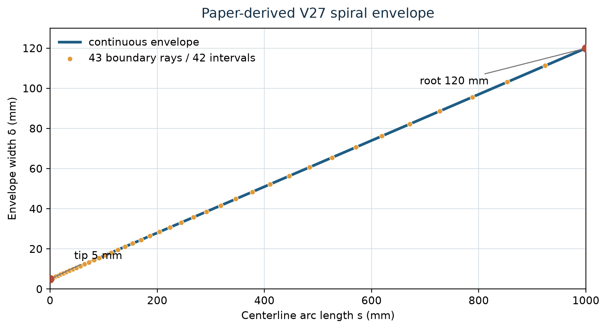
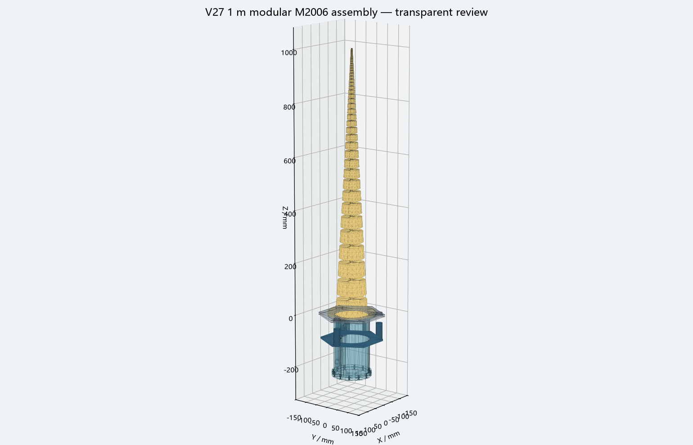

# 5 m 水深工况下 1 m 三缆对数螺旋机械臂几何推导与模型更新

**候选版本：** V27-1M-M2006 
**文档性质：** 工程几何推导稿，不是期刊发表稿，也不是水下验证报告 
**日期：** 2026-11-10

## 摘要

本文依据 SpiRobs 对数螺旋软体机器人论文的几何方程，重新计算项目 V27 一米三缆机械臂的连续螺旋函数及离散单元尺寸。输入采用论文一米样机的目标长度 1,000 mm、尖端/根部尺寸 5/120 mm 和 42 个离散单元。把该尺寸比代入论文中心线弧长方程后，数值求得增长参数 `b=0.140222015932`，并得到 `a=3.537542594481 mm`、`a₁=6.037542594481 mm` 和 `θ₀=22.664442592811 rad`。按每个四边形单元对应一个角区间离散，步长为 `30.918497752014°`，相邻缩放比为 `1.078604362321`；42 个中心线弧长区间的解析求和回到 1,000 mm。

5 m 水深仅作为淡水/海水环境边界。按代表性密度 1,000/1,025 kg/m³ 估算，5 m 外部静水表压约为 49.03/50.26 kPa。若干仓在近海平面气压下封闭，外壳差压可先按表压估算；最终仍要根据封仓气压、温度和压力测试工况确定。水深不进入对数螺旋方程；本推导不等于 TPU 强度、密封或整机耐压验证。

**关键词：** 对数螺旋；软体机械臂；三缆驱动；中心线弧长；五米水深

## 1. 设计对象与输入条件

| 项目 | 数值或解释 |
|---|---:|
| 中心线弧长目标 | 1,000 mm |
| 尖端/根部目标尺寸 | 5/120 mm |
| 离散单元 | 42 个四边形单元、42 个角区间、43 条边界射线 |
| 拉索与打印分段 | 3 路；四段打印、根部整体快换 |
| 设计水深 | 淡水与海水均为 5 m |

这里把论文中报出的尖端/根部尺寸，作为论文宽度函数 δ(θ) 在两端的目标宽度。二维宽度与最终三维截面外径完全相等，是本轮 CAD 几何采用的建模假设；三缆样机的截面修型、弹性轴、孔道、连接榫和打印公差可能改变最终实体测得的包络尺寸，需另行从 CAD/实物量测确认。

## 2. 论文几何方程

原始对数螺旋及其增长参数为：

$$
ρ(θ)=a·e^(bθ),  b=cot(ψ)
$$

中心螺旋系数为：

$$
ρ_c(θ)=a₁·e^(bθ),  a₁=(a/2)(e^(2πb)+1)
$$

机器人宽度和中心线弧长公式分别为：

$$
δ(θ)=a·e^(bθ)(e^(2πb)-1)
$$

$$
L(0,θ₀)=[√(1+b²)·a₁/b]·(e^(bθ₀)-1)
$$

## 3. 由端点尺寸和一米长度求解参数

尖端设为 θ=0，根部设为 θ=θ₀。根尖目标宽度比为：

$$
δ(θ₀)/δ(0)=120/5=24=e^(bθ₀)
$$

因此 θ₀=ln(24)/b。由 δ(0)=5 mm 得到 `a=5/(e^(2πb)-1)`；代入中心线定义后，`a₁=(5/2)·coth(πb)`。将这些关系代入论文长度公式，化为一个只含 b 的方程：

$$
1000 = 57.5·√(1+b²)/[b·tanh(πb)]
$$

对正根进行数值二分求解，得到：

| 参数 | 计算值 |
|---|---:|
| `b` | 0.140222015932 |
| `a` | 3.537542594481 mm |
| `a₁` | 6.037542594481 mm |
| `θ₀` | 22.664442592811 rad = 7.214316142137π |
| 极角切线角 `ψ` | 82.017913941° |
| 论文锥度角 `φ` | 6.581767372° |

故本次连续函数为：

$$
ρ(θ)=3.537542594481·e^(0.140222015932θ) mm
$$

$$
ρ_c(θ)=6.037542594481·e^(0.140222015932θ) mm
$$

$$
δ(θ)=5·e^(0.140222015932θ) mm,  0≤θ≤22.664442592811
$$

端点代回为 δ(0)=5 mm、δ(θ₀)=120 mm；中心线长度回算为 1000.000000000 mm。论文方程定义的是中心线弧长，不应与总装的轴向投影长度混称。

## 4. 42 单元离散化

论文通过固定角度区间构造一个四边形单元。V27 因此按 42 个单元对应 42 个等角区间、43 条边界射线处理：

$$
Δθ=θ₀/42=0.539629585543 rad=30.918497752014°
$$

相邻单元比例为：

$$
β=e^(bΔθ)=24^(1/42)=1.078604362321
$$

中心线的弧长坐标可写成 `K(e^(bθ)-1)`，其中 `K=√(1+b²)·a₁/b=43.478260869565 mm`。第 i 个区间的长度为：

$$
ℓ_i=K[e^(b(i+1)Δθ)-e^(biΔθ)],  i=0,…,41
$$

对 42 个理想角区间求和后，中间项相消，得到 `K(e^(bθ₀)-1)=1,000 mm`。尖端侧首个理想区间约 `3.417581 mm`，根部侧末个理想区间约 `76.044513 mm`。这些是连续中心线的弧长区间，不等同于三维 CAD 单元投影后的轴向包围尺寸。图 1 显示连续宽度包络和 43 条离散边界射线。

**图 1.** 对数螺旋宽度相对于中心线弧长呈线性变化；点列表示 42 个角区间的边界射线。

固定 `Δθ=30°` 与其余三项约束并不完全相容：固定 42 个角区间和 24:1 端点比时，方程给出 `b≈0.144515`，中心线长度约 945.50 mm，比目标短约 54.50 mm。因此 V27 将论文中的 30°示例视作离散参考，而由一米长度和端点尺寸求得实际步长。

## 5. 五米水深的压力边界

静水表压按 `p_g=ρgh` 计算，取 `h=5 m`、`g=9.80665 m/s²`，并使用淡水 1,000 kg/m³、代表性海水 1,025 kg/m³：

| 介质 | 假定密度 | 5 m 表压 | 加 101.325 kPa 标准大气压后的绝对压力 |
|---|---:|---:|---:|
| 淡水 | 1,000 kg/m³ | 49.033 kPa | 150.358 kPa |
| 海水 | 1,025 kg/m³ | 50.259 kPa | 151.584 kPa |

这些是密度假设下的静水压力估算；温度、当地盐度和水面气压没有实测。压力数值不改变 `a`、`b`、`θ₀` 或 `Δθ`。本次没有对 TPU 单元的压力变形、蠕变、疲劳、燕尾锁止、密封件寿命或舱体耐压作结构计算或试验；这些仍是独立验证项目。

## 6. V27 模型更新与导出

更新后的模型仍采用 42 个单元、三路拉索和四段臂体，根部快换法兰、M2006 整板驱动模块以及固定传动/轴封/湿侧线轮基座沿用 V27 模块接口。三个燕尾接口切入既有关节单元 5、10、18 内部，切面为：单元 5 内 Z=249.780 mm；单元 10 内 Z=501.635 mm；单元 18 内 Z=744.343 mm。第 5、10 单元使用其 CAD 轮廓中面；第 18 单元的切面相对中面向根部移 6 mm，以免末段软臂实体断开。各段范围为 1–5、5–10、10–18、18–42；燕尾榫轴向咬合 12 mm 并以横向锁销固定。当前最大打印段高度为 263.855 mm，低于 300 mm V27 合同限值。打印段如下：

| 打印段 | 单元范围 | 局部 Z 包络 (mm) | 导出文件 |
|---:|---:|---:|---|
| 1 | 1–5 | 261.78 | `SpiRobs_v27_打印段01_单元01-05.stl` |
| 2 | 5–10 | 263.85 | `SpiRobs_v27_打印段02_单元05-10.stl` |
| 3 | 10–18 | 254.71 | `SpiRobs_v27_打印段03_单元10-18.stl` |
| 4 | 18–42 | 255.66 | `SpiRobs_v27_打印段04_单元18-42.stl` |

四个 STL 各自平移到局部坐标系 `zmin=0`，XY 仍以机械臂中心为基准。另有四段臂体 STEP、完整 V27 总装 STEP、独立驱动和固定基座 STEP。CAD 导出流程完成总装预检并将 STEP 重新导入以确认文件可读；这些检查只支持当前 CAD 文件的几何/装配状态。

**图 2.** V27 一米臂体与现有模块化根部总装的半透明审查图。

## 7. 结论和适用范围

V27 连续螺旋函数及 42 区间配置由论文的端点宽度比、中心线长度关系和固定区间缩放关系导出；数值满足目标中心线弧长 1,000 mm 和理论宽度 5/120 mm。打印分段按设计切入单元 5、10、18 内部，以宽燕尾和横向锁销组合；第 18 单元切面向根部偏移 6 mm。5 m 深度只形成环境压力边界，不参与螺旋参数求解。三维外形尺寸与二维 `δ` 的对应、切片后的薄壁/支撑、材料刚度、根部承载、拉索摩擦、海水兼容性、5 m 水密和 30 分钟运行仍需后续验证。

## 参考文献

1. Wang, Z., Freris, N. M., & Wei, X. *SpiRobs: Logarithmic spiral-shaped robots for versatile grasping across scales*. Device, 3(4), 100646 (2025). https://doi.org/10.1016/j.device.2024.100646.
2. 作者预印本：arXiv:2303.09861, https://arxiv.org/abs/2303.09861.

## 附录：复算数据与复现文件

| 项目 | 复算值 |
|---|---:|
| 根尖宽度比 | 24:1 |
| 原始螺旋系数 `a` | 3.537542594481 mm |
| 中心螺旋系数 `a₁` | 6.037542594481 mm |
| 增长参数 `b` | 0.140222015932 |
| 根部相位 `θ₀` | 22.664442592811 rad |
| 单元角步长 `Δθ` | 30.918497752014° |
| 相邻单元比例 `β` | 1.078604362321 |
| 中心线弧长 | 1000.000000 mm |
| 单元弧长范围 | 3.418–76.045 mm |

数值记录位于 `V27螺旋参数.json`，计算实现位于 `spiral_parameters.py`。`build_spiral_derivation_report.py` 生成本报告的 Markdown 与 DOCX，`generate_v27_assembly.py` 生成 V27 的 CAD 文件。重新导出后仍需检查切片、材料试件、受力、密封和水下运行；报告中的公式回算不替代这些实体验证。
